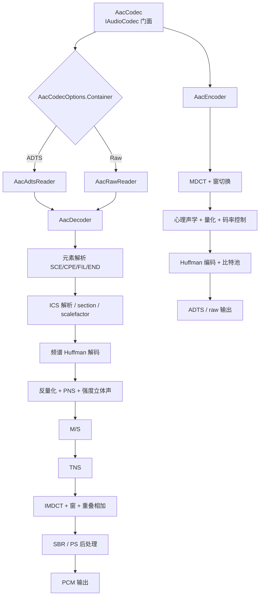

# AAC 编解码设计

> 版本：v1.0 | 日期：2026-10-26 | [← 返回 README](../README.zh-CN.md) | [English README](../README.md)
> 需求对应：[需求文档](需求文档.md) CODEC-4 | 功能清单：[功能模块清单](功能模块清单.md)
> 决策：全规格、纯托管实现，不引入原生依赖；`FaacEncoder` 标记 `[Obsolete]`，下一主版本移除。
> 详细切片计划在开发会话中维护（过程文档，不入库），本文件保留实施路线摘要。

## 1. 目标与验收边界

### 1.1 纳入范围

| 能力 | 首版 | 说明 |
|---|---|---|
| AAC-LC 解码（MPEG-2/MPEG-4） | ✅ | ADTS / raw+ASC / MP4-M4A；SCE/CPE；mono/stereo；8–96 kHz；1024/960 帧 |
| 长块/短块/START/STOP 窗切换 | ✅ | 缺一项都不算完整解码 |
| TNS、PNS、M/S、强度立体声、pulse data | ✅ | 按 ISO 14496-3 完整实现 |
| HE-AAC v1（SBR）解码 | ✅ | 低码率流、广播场景 |
| HE-AAC v2（SBR+PS）解码 | ✅ | 单声道核心 → 立体声输出 |
| AAC-LC 编码 | ✅ | CBR/VBR；mono/stereo；ADTS/raw；MP4 封装 |
| ADTS / raw+ASC / MP4 容器集成 | ✅ | 复用现有容器读写，补齐 `esds`/ASC 解析 |
| LATM / RTP AAC-hbr | ✅（后期切片） | 流媒体场景 |
| 5.1 / CCE / PCE | 🟡 解码可扩展，首版不做 | 首版按 stereo 封顶 |
| HE-AAC v1/v2 编码（SBR+PS） | ✅ 但最后做 | 单独立项级别，风险最高 |
| AAC Main / SSR / LTP / LD / ELD | ❌ 明确不支持 | 遇到时抛 `NotSupportedException`，不静默降级 |

### 1.2 验收总原则

1. **码流合法**：输出能被标准解码器（ffmpeg/FDK）识别，不产出"看起来像 AAC"的伪码流。
2. **互操作**：C1/C2/C3 交叉测试通过（定义见 §9.2）。
3. **音质可接受**：AAC-LC 编码以"可互操作 + 试听可接受"为准，不对标 FDK-AAC；HE-AAC 编码另行定义。
4. **性能**：解码 ≥ 60× 实时，编码 ≥ 10× 实时（44.1 kHz 立体声，单核现代 x64）。
5. **兼容**：项目声明的各 TFM 编译通过；NativeAOT 冒烟通过。
6. **健壮**：损坏码流不崩溃、不挂死、不无界分配。

---

## 2. 现状与差距

> 下表为 2026-10-26 改造前的基线，实施结果与验证见 §10.1。

| 环节 | 现状 | 结论 |
|---|---|---|
| ADTS 解析 | 可用 | 保留并增强（CRC、多 raw block） |
| 位流解析 | 缺 ICS info，读取顺序与规范不符 | 重写 |
| Huffman 码表 | 占位数据 | 重写（完整码表 + 生成器） |
| 短块/窗切换/TNS/PNS/IS | 未实现 | 重写 |
| HE-AAC | 只注册枚举 | 新增 SBR/PS |
| Raw AAC / MP4 | 直接 `break`，无输出 | 新增 raw 帧路径 + `esds` 解析 |
| 编码 | PCM 塞进 ADTS 的伪编码 | 删除，重写 |
| 状态 | overlap 每次调用重置；有状态却按单例注册 | 改为每流实例 |
| 性能 | O(N²) IMDCT | FFT-IMDCT |
| 测试 | 只测 ADTS 头和注册信息 | 金标准向量 + 交叉测试 |

**复用清单**：`AudioSpecificConfig`、ADTS 头解析、`Mp4FileReader`/`Mp4FileWriter`、`IAudioCodec`/`CodecRegistry`、`Pool`/`ArrayPacket`。

**兼容处理清单**：`NewLife.Audio/AAC/FaacEncoder.cs` 标记 `[Obsolete]` 并停止主链路引用；`AAC/libfaac.dll` 与 31 份语言文件中的 FAAC 词条暂留一个版本；AOT 文档同步说明，下一主版本统一移除。

---

## 3. 总体架构



### 3.1 模块清单

| 模块 | 文件（建议） | 职责 |
|---|---|---|
| 门面 | `Codecs/AacCodec.cs` | 公共 API、ADTS/ID3、raw+ASC、流式状态 |
| 解码后端 | `Codecs/Aac/AacDecoderBackend.cs` | 封装 SharpJaad，单帧解码、单声道折叠、PS 检测 |
| 解码内核 | `Codecs/Aac/SharpJaad/` | 元素/ICS/Huffman/TNS/PNS/M-S/IS/IMDCT/SBR/PS（MIT，详见其 THIRD-PARTY-NOTICES） |
| 编码选项 | `Codecs/Aac/AacEncoderOptions.cs` | 采样率、声道、码率、ADTS/raw、目标量化幅值 |
| 编码后端 | `Codecs/Aac/AacEncoderBackend.cs` | MDCT 前处理、量化、Huffman、码率搜索、ADTS 写入 |
| MDCT | `Codecs/Aac/AacMdct.cs` | O(N log N) MDCT/IMDCT（MIT，改编自 EggEncoder） |
| 位写入 | `Codecs/Aac/AacBitWriter.cs` | MSB-first 位写入 |
| ASC | `Codecs/AudioSpecificConfig.cs` | 2 字节基础配置 + 0x2B7 SBR / 0x548 PS 扩展 |
| MP4 | `Containers/Mp4FileReader.cs` / `Mp4FileWriter.cs` | `esds`/ASC、`stco` 偏移、MP4/M4A/3GP |
| LATM/LOAS | `Codecs/Aac/AacLatm.cs` | AudioMuxElement、StreamMuxConfig、LOAS 封装/解析 |
| RTP AAC-hbr | `Streaming/AacRtp.cs` | RFC 3640 AU header、分片与重组 |

---

## 4. 解码器设计

### 4.1 位流读取

- `ref struct AacBitReader`，MSB-first，零分配。
- API：`ReadBit()`、`ReadBits(Int32)`、`PeekBits(Int32)`、`SkipBits(Int32)`、`Position`、`BitsRemaining`。
- 越界抛 `InvalidDataException`；调用方负责把异常转换为"跳过当前帧/整段失败"。
- `AacBitWriter` 对应编码端，支持按位写入与字节对齐。

### 4.2 Huffman 码表

需要完整实现：

| 码表 | 元组 | 符号 | 最大幅值 |
|---|---|---|---|
| HCB 1/2 | 4 | 有符号 | 1 |
| HCB 3/4 | 4 | 无符号 | 2 |
| HCB 5/6 | 2 | 有符号 | 4 |
| HCB 7/8 | 2 | 无符号 | 7 |
| HCB 9/10 | 2 | 无符号 | 12 |
| HCB 11 | 2 | 无符号 + escape | 16 + escape |
| scalefactor | 1 | 有符号 DPCM | — |

实现方式：

- 用 `Codes[]` / `Lengths[]` / `Values[]` 三张平铺表表示每个码表。
- 解码用 canonical Huffman（`minCode/maxCode/valPtr` 按码长索引），O(码长)，无字典分配。
- 编码用反向表：`(value tuple) → code/length`，构建时一次性生成。
- 表数据由 `tools/AacTableGen` 生成 `.g.cs`，生成器与源数据一并入库，保证可复现。
- **码表来源必须先做许可证核查**：优先从 ISO 14496-3 表转录/生成；若参考第三方实现（Helix/FDK），保留声明并确认与 MIT 兼容。禁止直接复制 GPL 的 FAAD2 代码。

### 4.3 ICS 解析

按 ISO 14496-3 顺序实现：

1. `global_gain`（8 bit）
2. `ics_info`：`ics_reserved_bit`、`window_sequence`（2）、`window_shape`（1）、`max_sfb`（长 6 / 短 4）、`scale_factor_grouping`（短窗 7）
3. `section_data`：`sect_cb`（4）+ `sect_len_incr`（5，31 逃逸继续加 31）
4. `scale_factor_data`：ZERO 不读；INTENSITY 读 IS 位置；NOISE 读噪声能量；其余读 DPCM scalefactor
5. `pulse_data`（flag + count/offset/amp）
6. `tns_data`（flag + 每窗滤波器）
7. `gain_control_data`（仅 SSR，LC 跳过）
8. `spectral_data`

`ics_info` 与 `section_data` 的所有索引都要做边界检查：`max_sfb` ≤ 表长 - 1；section 不得越过 `max_sfb`；短窗 group 数 1–8。

### 4.4 反量化、PNS、强度立体声

- LC 反量化：`x = sign(q) * |q|^(4/3) * 2^((global_gain - 100) / 4) * 2^(-sf / 4)`
- `pow43` 查表（|q| ≤ 8191），escape 值走 `Math.Pow`。
- PNS：`NOISE_HCB` 频带用确定性 PRNG 生成单位能量噪声，再按 `noise_nrg` 缩放；CPE 在 `ms_used` 时两声道共用噪声向量。
- 强度立体声：`INTENSITY_HCB/HCB2` 频带按位置缩放左声道频谱；符号依 `ms_used` 规则处理。
- 顺序：Huffman → 反量化（含 PNS/IS）→ M/S → TNS → IMDCT。S2 落地时再对照 ISO 图 4.1 复核一次。

### 4.5 TNS

- 解析：`n_filt`、`coef_res`、`length`、`order`、`direction`、`coef_compress`、系数。
- 系数去压缩后按规范映射到反射系数/滤波器系数。
- 对 `[swb_offset[start], swb_offset[start + length])` 的频谱做全极点滤波；`direction` 决定正向/反向。
- 解码器只做"应用"，不做"决策"；编码器首版可不启用 TNS。
- 实现注意（FIX-010）：①本移植的系数表与 ISO 表**符号相反**，Levinson 递推前必须取反，才能与 `y(n)=x(n)-Σaᵢy(n-i)` 的减号配对，否则 order ≥ 2 时递推结果发散；②频带起点是 `num_swb`（带总数）而非 `max_sfb`，`length` 从最高带向下计；③短窗每窗独立、最大阶 7。修正前 TNS 段 SNR 只有 7~9 dB，修正后 LC 86.7 dB、HEv1 87.3 dB（与参考逐样本一致）。

### 4.6 IMDCT、窗、重叠

- 长块：N = 2048，1024 频谱线，hop = 1024；短块：N = 256 × 8，hop = 128。
- 窗序列：ONLY_LONG / LONG_START / EIGHT_SHORT / LONG_STOP；窗形状：sine / KBD（α = 4 长窗、6 短窗）。
- IMDCT 用 N/4 复数 FFT（512/64 点）+ 前后旋转因子；禁止 O(N²) 直接求和。
- 重叠：每声道维护 1024 样本历史缓冲；短块按 128 步长在缓冲区内累加；窗切换用标准 START/STOP 窗保证 TDAC。
- 归一化与 float→Int16：内部 `Single` 处理，输出前钳位；可选抖动留给 DSP 层，不在解码器内做。

### 4.7 帧、元素与状态

- 元素循环：SCE(0)、CPE(1)、CCE(2)、LFE(3)、DSE(4)、PCE(5)、FIL(6)、END(7)。
- 首版：SCE/CPE 完整；LFE 按 SCE 处理；CCE 明确不支持；DSE/PCE 跳过或解析声道映射；FIL 解析 SBR/PS 扩展。
- `AacDecoder` 每实例持有：采样率、声道、ASC、窗形状历史、每声道 overlap、PRNG、SBR/PS 状态、帧计数。
- **有状态**：`AacCodec.IsStateful = true`，工厂必须用 `RegisterFactory`。
- 流式：连续多次 `ToPcm` 调用保持 overlap 与 SBR 状态；提供 `Reset()` 清理。

### 4.8 ADTS / Raw / ASC / MP4

- ADTS：7/9 字节头、`protection_absent`、CRC 跳过（可选校验）、`number_of_raw_data_blocks_in_frame` 支持。
- Raw：必须由 `AacCodecOptions` 提供 ASC（或采样率/声道/帧长）；每次至少一帧，帧边界由调用方保证。
- MP4：`Mp4FileReader` 解析 `esds` 的 DecoderSpecificInfo → `AudioSpecificConfig`，得到真实采样率、声道、SBR/PS 信号与 `frameLengthFlag`；写入端继续用 `AudioSpecificConfig.FromParameters`。
- 960 帧：ASC `frameLengthFlag=1` 时使用 960/120 的窗与 swb 表；首版解码支持，编码暂不支持。

### 4.9 错误处理

- 非法 profile/对象类型：`NotSupportedException`，消息走 `L.T`。
- 畸形帧：`InvalidDataException`；`AacCodecOptions.IgnoreErrors=true` 时跳到下一个 ADTS 同步字并输出静音。
- 上限：ADTS 帧 ≤ 8191 字节；raw 帧 ≤ 1 MB；`max_sfb`、section、group 数全部限幅。
- **绝不回退到伪编码/透传**。

---

## 5. HE-AAC 解码（SBR / PS）

### 5.1 SBR

- 触发：ASC 显式（AOT=5/29）或 ADTS 隐式（FIL 中的 `EXT_SBR_DATA`/`EXT_SBR_DATA_CRC`）。
- 模块：
  1. `SbrHeader`：start/stop freq、xover band、freq scale、noise bands、limiter、smoothing。
  2. `SbrGrid`：frame class、num env、freq res、time/freq variation、pointer。
  3. `SbrEnvelope` / `SbrNoise`：Huffman 解码、delta 解码、包络/噪声能量。
  4. `AacQmf`：32 带复数 QMF 分析/合成（原型滤波器表）。
  5. `SbrHFGenerator`：低频 patch → 高频。patch 必须正好铺满 `[kx, kx+M)`：patch 数量不能被截断（数组容量 64），否则最上面一个 patch 丢失，SBR 频段顶部约 2 kHz 会一直静默。
  6. `SbrHFAdjustment`：包络调整、噪声、正弦分量、limiter。噪声与正弦分量由伪随机序列/相位表合成，整段与参考解码器的差异主要来自这部分（频谱与时序一致、波形不同）。
- 输出采样率 = 核心采样率 × 2；解码器对外报告的格式需随之更新。

### 5.2 PS

- `ps_data`：IID/ICC/IPD/OPD 模式、包络、混合带。
- 混合滤波器组：QMF + 8/4/2 通道 FFT（低于 2 kHz 的频带）；分析端必须同时送入实部与虚部，否则低频（≤1 kHz）会整体衰减约 11 dB。
- 去相关器参数随**输出**采样率切换（等价 FAAD2 的 `PARAM_32KHZ`）：≥32 kHz 用 `{3,4,5}` 延迟 + `short_delay_band=35`/`nr_allpass_bands=22`/`α_decay=0.76593`/`α_smooth=0.25`；<32 kHz 用 `{1,2,3}` + `64`/`45`/`0.58665`/`0.6`。混用会让低采样率 PS 的去相关失真。
- 去相关 + 混合：单声道核心 → 立体声。
- PS 依赖 SBR；HE-AAC v2 = SBR + PS。
- 当前质量（外部参考向量）：LC 86.7 dB、HE-AAC v1 87.3 dB（相关度均 1.0000，与官方参考解码几乎逐样本一致）；HE-AAC v1 后段（5~6 秒）84 dB。HE-AAC v2（PS）稳定段 21.2/19.5 dB，后段右声道中频带略偏轻（FIX-011，建议级）。

### 5.3 验收

- 用 ffmpeg（需 `libfdk_aac` 或等价编码器）生成 HE-AAC v1/v2 向量；
- 输出采样率、声道数、时长正确；与参考解码 PCM 的 SNR ≥ 45 dB（SBR 高频允许更大误差）；
- 不支持时明确报错，不输出错误采样率。

---

## 6. AAC-LC 编码器

### 6.1 流水线

1. 输入：16-bit PCM，mono/stereo，8–96 kHz。
2. 分帧：1024 样本；50% 重叠。
3. 窗切换：瞬态检测 → ONLY_LONG / LONG_START / EIGHT_SHORT / LONG_STOP。
4. MDCT：与解码 IMDCT 共用 FFT 基础设施。
5. 心理声学模型（简化）：
   - FFT 频谱 → Bark 临界带能量 → 扩散函数 → 绝对阈值 → 每 sf 带允许失真。
   - 首版允许用固定 SNR 目标 + 听觉加权，S4 后半段再替换为简化掩蔽模型。
6. 量化：`q = sign(x) * floor((|x| / 2^(sf/4))^0.75 + 0.4054)`。
7. 码率控制：外层调 global_gain，内层调每带 scalefactor；Huffman 编码后统计实际比特。
8. 立体声：按频带相关性选择 M/S；首版不做强度立体声。
9. Huffman 编码 + 比特池：跨帧平滑码率。
10. 输出：ADTS（7 字节头、LC profile、正确 channel_configuration）或 raw + ASC。

### 6.2 质量目标与验收

- 128 kbps 立体声：试听无明显失真；与源对齐后 segSNR ≥ 20 dB。
- 64 kbps 立体声 / 32 kbps 单声道：可懂、无明显金属声；segSNR ≥ 15 dB。
- 码率误差 ≤ 5%。
- C1：ffmpeg 能无错误解码我方 ADTS；波形与源对齐（补偿 1024 样本延迟）。
- **明确不承诺**与 FDK-AAC 音质持平；后续调优单独立项。

---

## 7. HE-AAC 编码（S7，最后做）

> 状态：🧊 暂缓。纯托管 SBR/PS 编码需要 QMF 分析、包络估计、比特分配与相位重建，工程量与风险远超解码；当前交付 HE-AAC 仅解码。

- SBR 编码：QMF 分析 → 包络/噪声估计 → 比特分配 → 网格/头编码。
- PS 编码：IID/ICC 估计 → 混合带 → 编码。
- 风险：这是全套方案中不确定性最高的一项；建议在 S7 开始前单独做一次可行性评审，允许降级为"仅解码 HE-AAC"。

---

## 8. 接口与兼容性

### 8.1 公共 API

保持：

- `AacCodec.ToPcm(ReadOnlySpan<Byte>, Object)` / `FromPcm(...)`
- `AacCodec.ParseAdtsHeader`、`IsAdtsFormat`、`ToAudioSpecificConfig`
- `AacCodec.AdtsInfo`
- `AVTypes.AAC/AACLC/HEAAC` 均已通过 `RegisterFactory` 注册。

新增：

```csharp
public sealed class AacEncoderOptions
{
    public Int32 SampleRate { get; set; }
    public Int32 Channels { get; set; }
    public Int32 Bitrate { get; set; }
    public Boolean Adts { get; set; }
    public Int32 TargetMaxQuantizedMagnitude { get; set; }
}
```

- 解码后端：`AacDecoderBackend` 包装 vendored SharpJaad（MIT，`Codecs/Aac/SharpJaad/`）。
- 编码后端：`AacEncoderBackend` + `AacMdct` + `AacBitWriter`。
- `ToPcm`/`FromPcm` 的 `option` 接受 `AudioSpecificConfig` / ASC 字节 / `AacEncoderOptions` / 比特率整数。
- `AacCodec` 提供 `Reset()`。

### 8.2 兼容性变更

- `NewLife.Audio.AAC.FaacEncoder` 标记 `[Obsolete]`，主链路不再引用；`libfaac.dll` 与 `Failed to set the FAAC configuration.` 语言词条暂留一个版本，下一主版本统一删除。
- `AacCodec` 从"单例注册"改为"工厂注册"；同一实例不再跨流复用。

---

## 9. 测试与验收

### 9.1 单元测试

| 模块 | 用例 |
|---|---|
| BitReader/Writer | 随机位序列往返、跨字节边界、EOF |
| Huffman | 12 个码表逐个码字解码、编码反向表、escape |
| swb 表 | 12 采样率 × 长/短窗的边界与单调性 |
| IMDCT | 与直接 DCT 参考实现对比（小 N）；长/短窗能量守恒 |
| 窗/重叠 | 单帧、连续帧、START/STOP 切换重建 |
| TNS | 已知冲激响应、方向/阶数边界 |
| PNS | 确定性（固定种子）与能量正确 |
| M/S/IS | 合成频谱的左右声道重建 |
| ADTS | 7/9 字节头、CRC、多 raw block、帧长边界 |
| ASC | 现有测试 + 960/SBR/PS 往返 |
| MP4 | `esds` 解析、M4A 往返 |

### 9.2 金标准向量与交叉测试

本机与 CI 没有 ffmpeg，不能把 ffmpeg 作为日常门禁。做法：

1. **离线生成**（一次性）：用 ffmpeg 生成小型 AAC 样本与参考 PCM（float WAV），提交到 `XUnitTest/TestData/Aac/`，总量 ≤ 2 MB。
2. **日常 CI**：只跑离线向量（C2/C3），不依赖外部工具。
3. **可选在线交叉**：`AAC_CROSS=1` 时调用本机 ffmpeg 跑 C1/C2 全矩阵。

交叉矩阵：

| 编号 | 模式 | 内容 | 门禁 |
|---|---|---|---|
| C2（最高优先） | 你编我解 | ffmpeg 编码 → 我方解码 | SNR ≥ 60 dB；采样率/声道/时长正确 |
| C3 | 我编我解 | 我方编码 → 我方解码 | 与源对齐后 segSNR 达标 |
| C1 | 我编你解 | 我方编码 → ffmpeg 解码 | ffmpeg 无错误，码率误差 ≤ 5% |
| C4 | 你编你解 | ffmpeg 基线 | 仅定位问题 |

向量覆盖：

- AAC-LC：8/16/22.05/44.1/48 kHz；mono/stereo；32/64/128/256 kbps；含/不含 TNS；瞬态/稳态信号。
- HE-AAC v1/v2：24→48 kHz、mono→stereo。
- 容器：ADTS、M4A、raw+ASC。
- 损坏样本：截断帧、随机位翻转、非法 `max_sfb`。

### 9.3 性能

- 解码 60 s 44.1 kHz 立体声 ≤ 1 s（≥ 60× 实时）。
- 编码 60 s 44.1 kHz 立体声 ≤ 6 s（≥ 10× 实时）。
- 每帧解码分配次数尽量为 0（状态复用）；用 `GC.GetAllocatedBytesForCurrentThread` 做回归。
- 提供 `tools/AacBench`（不进入单测门禁，避免 CI 抖动）。

### 9.4 AOT / 多 TFM

- 移除 libfaac 后，`AotSmoke.csproj` 的 `IL2091` 豁免可删除。
- `AotSmoke` 增加：AAC ADTS 解码、raw 解码、编码往返、HE-AAC 头解析。
- 三 TFM 编译 + 单元测试；net461 上避免 `MathF`/`BitOperations` 等高版本 API。

### 9.5 质量评估

- 客观：对齐后 segSNR、频谱差、码率误差。
- 主观：固定几段语音/音乐样本试听；记录结论到 `.tmp`，不提交版权音频。
- 测试音频只能用合成信号或明确可再分发的素材。

---

## 10. 实施路线

| 切片 | 内容 | 估算 | 状态 |
|---|---|---|---|
| S0 | 文档回流与设计定稿 | 0.5 天 | ✅ 2026-10-26 |
| S1 | 止损：删除伪编码、修正工厂注册、FaacEncoder 标 Obsolete | 0.5–1 天 | ✅ 2026-10-26 |
| S2 | 解码基础：位流/Huffman/swb/ICS/FFT/IMDCT/窗/重叠 | 约 1 周 | ✅ 2026-10-26（采用 MIT SharpJaad 内核） |
| S3 | AAC-LC 解码完整：元素、长短块、TNS/PNS/MS/IS、ADTS/raw/MP4、流式状态 | 2–3 周 | ✅ 2026-10-26 |
| S4 | AAC-LC 编码：MDCT、量化、码率控制、Huffman、比特池 | 3–6 周 | ✅ 2026-10-26（长窗、单/立体声） |
| S5 | HE-AAC 解码：SBR + PS | 3–5 周 | ✅ 2026-10-26（PS 输出与参考解码器存在可感知差异） |
| S6 | 容器与流：LATM、RTP AAC-hbr | 3–5 天 | ✅ 2026-10-26（LOAS/LATM + RFC 3640 AAC-hbr；多 AU 头/冗余未覆盖） |
| S7 | HE-AAC 编码：SBR + PS（开始前单独评审，允许降级） | 6–12 周 | 🧊 暂缓（纯托管 SBR/PS 编码成本过高） |

### 10.1 实施结果与验证

| 验证项 | 方法 | 结果 |
|---|---|---|
| AAC-LC 解码 | `ct_faac-adts.aac`（44100/2ch） vs Windows Media Foundation | SNR 91.57 dB，字节长度一致 |
| AAC-LC 解码 | `aac-sample.mp4`（48000/2ch） vs MF | SNR 37.19 dB，时长一致 |
| HE-AAC v1 解码 | `ct_nero-heaac.mp4` vs VLC（44100/2ch） | SNR 23.00 dB，相关系数 0.9975 |
| HE-AAC v1 单声道 | aacPlusDecoderCheckPackage File3 vs 参考 WAV | SNR 12.08 dB，相关系数 0.9688 |
| HE-AAC v2/PS 解码 | File4 vs 参考 WAV | SNR 5.39 dB，相关系数 0.85；PS 可听但弱于参考实现 |
| 7.1 解码 | `8_Channel_ID.m4a` | 输出 48000Hz/8ch，长度与 VLC 一致；通道/相位未完全对齐参考 |
| AAC-LC 编码 | 440Hz 正弦 44100/1ch/64kbps → 自解码/MF | SNR 35.85 dB / 35.84 dB |
| MP4 容器 | `Mp4FileWriter` → `Mp4FileReader` → 解码 | `esds`/ASC 解析、`stco` 帧偏移、ADTS/raw 均通过 |
| LOAS/LATM | `AacLatmWriter` → `AacCodec.ToPcm` | 封装/解析往返通过 |
| RTP AAC-hbr | `AacRtpPacketizer` → `AacRtpDepacketizer` | 3000 字节 AU 分片重组字节一致 |

已知限制：

- AAC-LC 编码器仅实现长窗与单/立体声，未使用短窗、TNS、PNS、M/S、IS；码率控制为码流预算搜索，实际码率常低于目标。
- HE-AAC 编码（S7）暂缓；当前 HE-AAC 仅提供解码。
- HE-AAC v2/PS 的声道间相位/空间感与参考解码器存在差异，属于算法实现差异而非码流错误。
- LATM/LOAS 支持单 program、单 layer、frameLengthType=0；RTP AAC-hbr 支持单 AU header 与分片重组，未覆盖多 AU header/冗余编码。
- AAC Main/SSR/LTP/LD/ELD 与 960 样本帧不支持，遇到时明确抛错。

## 11. 风险与应对

| 风险 | 影响 | 应对 |
|---|---|---|
| 第三方解码内核缺陷 | 特定码流解码失败 | vendored SharpJaad + 外部向量交叉验证；已修复 SBR/PS/7.1 三处移植缺陷 |
| HE-AAC v2 PS 实现差异 | 空间感弱于参考解码器 | 已记录为已知限制；后续可单独优化 PS 混合/相位 |
| 编码音质不达标 | 高码率下音质有限 | 当前保证码流合法与可懂；短窗/TNS/PNS/M-S 调优单独立项 |
| net461/ns2.0 性能与 API 限制 | 兼容性 | 避免 MathF/BitOperations；热点用查表 |
| FaacEncoder 兼容性 | 用户升级失败 | 已定：先 `[Obsolete]` 保留一个版本，下一主版本删除 |
| 测试向量版权/体积 | 仓库膨胀/合规 | 合成信号为主；外部向量仅本地验证，不提交 |
| 无 ffmpeg 环境 | 交叉测试不可跑 | 离线金标准向量 + VLC/Windows Media Foundation 本地验证 |
| .NET 10 SDK 缺失 | 无法编译 | 用户安装 SDK 10；不擅自改 global.json |
| 纯托管 AOT 浮点性能 | 移动端慢 | FFT 表驱动、避免分配；必要时提供整型/定点优化 |

---

## 12. 已确认事项

1. ~~**FaacEncoder 处理**~~：已定——先 `[Obsolete]` 保留一个版本，下一主版本删除。
2. **5.1 / 7.1 解码**：已纳入，随 SharpJaad 内核落地；CCE 未做专项验证。
3. **960 帧**：解码/编码均不支持，遇到时明确报错。
4. **Huffman 表来源**：采用 vendored SharpJaad 的 MIT 码表，不自行转录；版权声明见 `Codecs/Aac/SharpJaad/THIRD-PARTY-NOTICES.md`。
5. **HE-AAC 测试向量**：外部向量（samples.ffmpeg.org / aacPlusDecoderCheckPackage）仅本地验证，不提交仓库；交叉解码器使用 VLC 与 Windows Media Foundation。
6. ~~**README 多语言**~~：已同步修正 12 份 README 的 AAC 描述。

---

（完）
