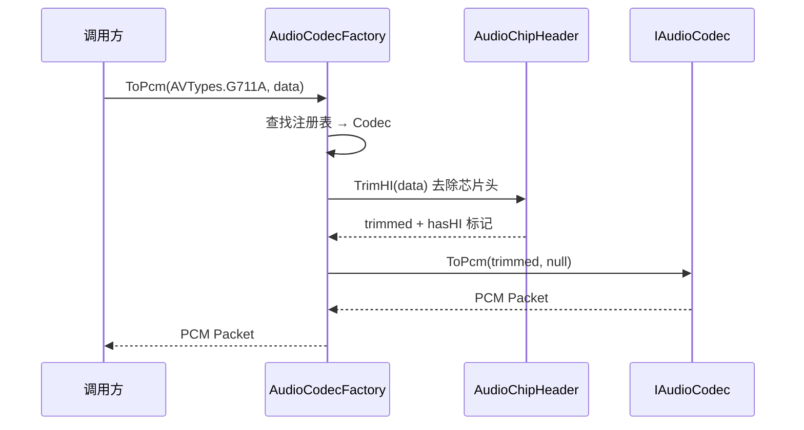
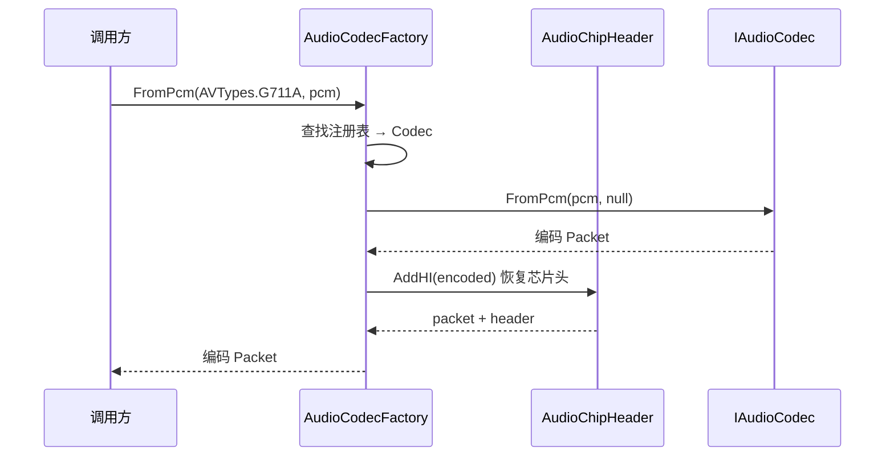
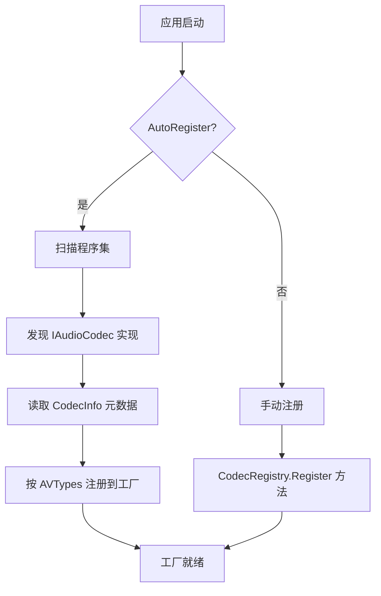

# CODEC-编解码引擎

> 版本：v1.1 | 日期：2026-07-20 | [← 返回 README](../Readme.MD) | [English README](../Readme.en.MD)
> 需求对应：[需求文档](需求文档.md) 第 2 章 | 功能清单：[功能模块清单](功能模块清单.md)

---

## 1. 模块职责

| 职责 | 说明 |
|---|---|
| 编解码路由 | 根据编码类型（`AVTypes` 枚举或自定义标识）将数据路由到正确的编解码器 |
| PCM 双向转换 | 提供统一接口 `IAudioCodec`，输入编码数据→输出 PCM，或输入 PCM→输出编码数据 |
| 芯片音频头适配 | 自动识别和去除 IoT 芯片对音频数据的包装头（海思/大华/宇视等），解码后还原 |
| 编解码器生命周期 | 管理编解码器实例的创建、复用和释放（有状态/无状态编解码器分别处理） |
| 格式自动检测 | 根据数据特征自动推断音频编码格式，降低调用方心智负担 |

---

## 2. 核心组件

| 组件 | 说明 |
|---|---|
| `IAudioCodec` | 编解码器统一接口：`ToPcm(ReadOnlySpan<Byte>, Object)` / `FromPcm(ReadOnlySpan<Byte>, Object)`，返回 `IPacket` |
| `ICodecInfo` | 编解码器元数据接口，提供名称、版本、`IReadOnlyCollection<AVTypes>` 支持格式、是否为有状态编解码器等 |
| `AudioCodecFactory` | 编解码工厂，管理 `CodecRegistry` 注册表和芯片头处理链，根据 `AVTypes` 路由编解码 |
| `CodecRegistry` | 编解码器注册表，支持无状态单例 `Register()` 和有状态工厂 `RegisterFactory()` 两种注册模式 |
| `ADPCMCodec` | IMA ADPCM 编解码器（无状态，类级单例） |
| `G711ACodec` | G.711 A-law 编解码器（无状态，类级单例） |
| `G711UCodec` | G.711 μ-law 编解码器（无状态，类级单例，查表法实现） |
| `AacCodec` | AAC 编解码器（纯托管解码，编码通过 `FaacEncoder` 包装 libfaac 原生库） |
| `OpusCodec` | Opus 编解码器（纯托管 CELT 实现，有状态，工厂模式创建实例） |
| `Mp3Codec` | MP3 编解码器（纯托管解码） |
| `FlacCodec` | FLAC 编解码器（纯托管，Fixed LPC + LPC 子帧 + Rice 残差编码） |
| `VorbisCodec` | Ogg Vorbis 编解码器（纯托管） |
| `SpeexCodec` | Speex 编解码器（纯托管窄带 CELP 实现） |
| `G722Codec` / `G726Codec` | G.722/G.726 电信语音编解码器（无状态） |
| `IAudioChipHeader` | 芯片音频头接口：`HeaderSize` 属性 + `TryTrim(ReadOnlySpan<Byte>, out IPacket)` / `TryAdd(ReadOnlySpan<Byte>, out IPacket)` |

---

## 3. 关键流程

### 3.1 解码流程（设备音频 → PCM）



### 3.2 编码流程（PCM → 设备音频）



### 3.3 编解码器注册流程



---

## 4. 接口/数据结构

### 4.1 核心接口（已有 + 扩展）

```csharp
/// <summary>音频编解码器接口</summary>
public interface IAudioCodec
{
    /// <summary>编码数据转为 PCM</summary>
    IPacket ToPcm(ReadOnlySpan<Byte> audio, Object option);

    /// <summary>PCM 转为编码数据</summary>
    IPacket FromPcm(ReadOnlySpan<Byte> pcm, Object option);
}

/// <summary>编解码器元数据</summary>
public interface ICodecInfo
{
    /// <summary>编解码器名称</summary>
    String Name { get; }

    /// <summary>版本号</summary>
    String Version { get; }

    /// <summary>支持的编码类型集合</summary>
    IReadOnlyCollection<AVTypes> SupportedTypes { get; }

    /// <summary>是否为有状态编解码器（需要创建新实例处理每个流）</summary>
    Boolean IsStateful { get; }
}
```

### 4.2 编解码工厂

```csharp
/// <summary>编解码工厂</summary>
public class AudioCodecFactory
{
    /// <summary>编解码器注册表</summary>
    public CodecRegistry Registry { get; }

    /// <summary>注册自定义编解码器</summary>
    public void Register(AVTypes avType, IAudioCodec codec);

    /// <summary>根据编码类型解码</summary>
    public IPacket ToPcm(AVTypes avType, IPacket data);

    /// <summary>根据编码类型编码</summary>
    public IPacket FromPcm(AVTypes avType, IPacket pcm);

    /// <summary>去除芯片头</summary>
    public IPacket TrimHI(IPacket data, out Boolean trim);

    /// <summary>添加芯片头</summary>
    public IPacket AddHI(IPacket data);
}

/// <summary>编解码器注册表</summary>
public class CodecRegistry
{
    /// <summary>注册无状态编解码器（单例复用）</summary>
    public void Register(AVTypes avType, IAudioCodec codec);

    /// <summary>注册有状态编解码器工厂（每次创建新实例）</summary>
    public void RegisterFactory(AVTypes avType, Func<IAudioCodec> factory);

    /// <summary>获取编解码器</summary>
    public IAudioCodec GetCodec(AVTypes avType);

    /// <summary>检查是否支持指定编码类型</summary>
    public Boolean IsSupported(AVTypes avType);
}
```

### 4.3 芯片音频头处理

```csharp
/// <summary>芯片音频头处理器</summary>
public interface IAudioChipHeader
{
    /// <summary>芯片头字节数</summary>
    Int32 HeaderSize { get; }

    /// <summary>尝试去除音频头</summary>
    Boolean TryTrim(ReadOnlySpan<Byte> data, out IPacket result);

    /// <summary>尝试添加音频头</summary>
    Boolean TryAdd(ReadOnlySpan<Byte> data, out IPacket result);
}

// 已有实现：HisiliconHeader / DahuaHeader / UniviewHeader
```

---

## 5. 设计决策

| 决策 | 理由 |
|---|---|
| 接口使用 `ReadOnlySpan<Byte>` + `IPacket` 返回 | `ReadOnlySpan<Byte>` 零拷贝输入，`IPacket` 是 NewLife 标准高性能缓冲区 |
| 无状态编解码器使用类级单例 | 如 G.711/ADPCM/G.722/G.726 不保存流状态，一个实例服务多路数据，避免重复分配 |
| 有状态编解码器通过工厂创建 | 如 Opus/AAC/FLAC 需保存帧间状态，`RegisterFactory` 为每个流创建独立实例 |
| `option` 参数保留 `Object` 类型 | 各编解码器配置差异大，统一为 `Object` 避免接口膨胀 |
| 芯片头处理独立接口 | 便于新增厂商适配，不修改工厂核心逻辑 |

---

（完）
