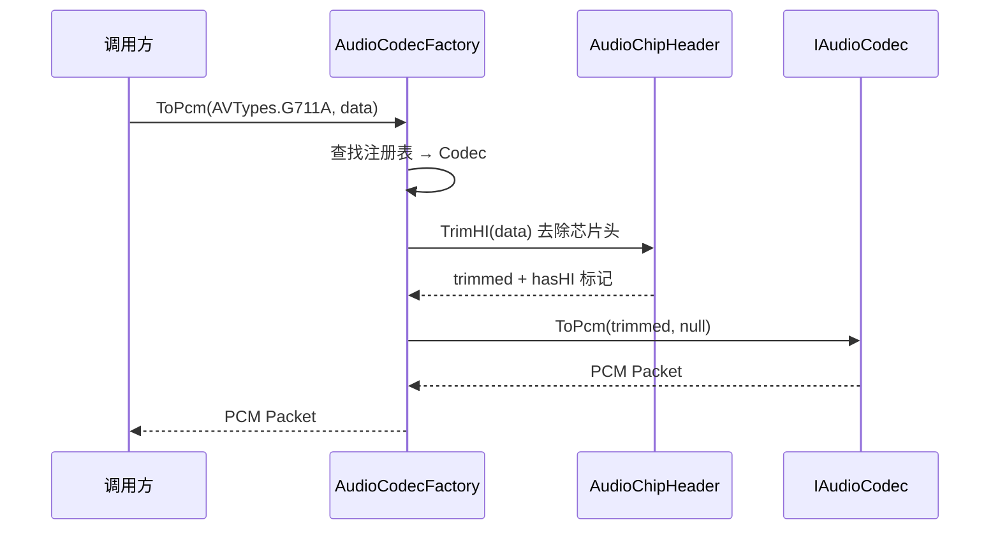
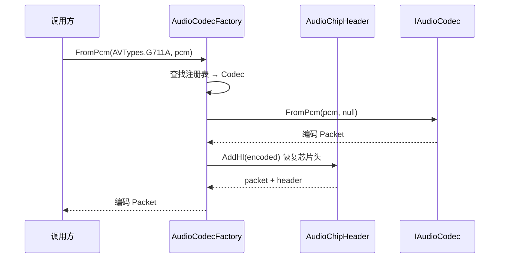
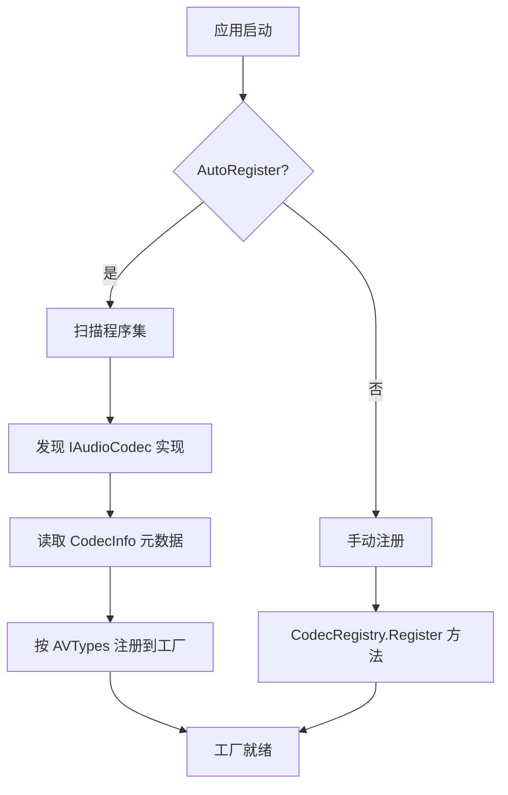

# CODEC-编解码引擎

> 版本：v1.5 | 日期：2026-10-26 | [← 返回 README](../README.zh-CN.md) | [English README](../README.md)
> 需求对应：[需求文档](需求文档.md) 第 2 章 | 功能清单：[模块清单](模块清单.md)

---

## 1. 模块职责

| 职责 | 说明 |
|---|---|
| 编解码路由 | 根据编码类型（`AVTypes` 枚举或自定义标识）将数据路由到正确的编解码器 |
| PCM 双向转换 | 提供统一接口 `IAudioCodec`，输入编码数据→输出 PCM，或输入 PCM→输出编码数据 |
| 芯片音频头适配 | 自动识别和去除 IoT 芯片对音频数据的包装头（海思/大华/宇视等），解码后还原 |
| 编解码器生命周期 | 管理编解码器实例的创建、复用和释放（有状态/无状态编解码器分别处理） |
| 格式与载荷识别 | 容器层按扩展名/魔术字节识别文件格式；RTP/GB28181 场景按 `AVTypes` 载荷类型路由。编解码器本身不做"盲猜编码" |

---

## 2. 核心组件

| 组件 | 说明 |
|---|---|
| `IAudioCodec` | 编解码器统一接口：`ToPcm(ReadOnlySpan<Byte>, Object)` / `FromPcm(ReadOnlySpan<Byte>, Object)`，返回 `IPacket` |
| `ICodecInfo` | 编解码器元数据接口，提供名称、版本、`IReadOnlyCollection<AVTypes>` 支持格式、是否为有状态编解码器等 |
| `AudioCodecFactory` | 编解码工厂，管理 `CodecRegistry` 注册表和芯片头处理链，根据 `AVTypes` 路由编解码 |
| `CodecRegistry` | 编解码器注册表，支持无状态单例 `Register()` 和有状态工厂 `RegisterFactory()` 两种注册模式 |
| `ADPCMCodec` | IMA ADPCM 编解码器（无状态，类级单例） |
| `G711ACodec` | G.711 A-law 编解码器（无状态，类级单例） |
| `G711UCodec` | G.711 μ-law 编解码器（无状态，类级单例，查表法实现） |
| `AacCodec` | AAC 编解码器（纯托管：AAC-LC/HE-AAC v1/v2 解码 + AAC-LC 编码；ADTS/raw+ASC/MP4-M4A/3GP；详见 [AAC 编解码设计](AAC-编解码设计.md)） |
| `OpusCodec` | Opus 编解码器（自研路线：包解析 + 范围编码器已就绪，M2~M5 完成 CELT/SILK；当前降级调用系统 ffmpeg，有状态，工厂模式创建实例） |
| `OpusOptions` | Opus 选项：采样率、声道、比特率、帧时长、VBR/DTX/FEC/复杂度/带宽/信号类型 |
| `OpusPacket` | Opus 包结构解析（`ref struct`，TOC、Code 0~3、帧数/帧长、VBR/CBR、padding） |
| `OpusPacketHeader` | Opus 包 TOC 解析的兼容层：模式、带宽、声道、帧数、每帧样本数与总时长 |
| `OpusRangeDecoder` / `OpusRangeEncoder` | RFC 6716 范围编解码器，供 CELT/SILK 使用的熵编码基础 |
| `OpusManagedCodec` | 进程内托管编解码切换点（M1 不可用，M2 起逐步开启） |
| `OpusProcessCodec` | 操作系统降级：探测 ffmpeg + libopus，通过 stdin/stdout 完成单包编解码 |
| `Mp3Codec` | MP3 编解码器（纯托管双向：解码 MPEG-1/2/2.5、长短块、联合立体声、比特池、Xing/Info/VBRI 信息帧、坏帧错误隐藏与 CRC 校验；编码 Layer III，支持 CBR/VBR/ABR、M/S 联合立体声、简化心理声学模型、编码比特池与可选 CRC） |
| `Mp3Layer3Encoder` | MP3 Layer III 编码器：多相分析 → MDCT → 反混叠折叠 → 量化 → Huffman（含 ESC 表）→ 帧组装，支持 9 档采样率、单/立体声、M/S、VBR/ABR、Xing 信息帧、跨帧比特池与 CRC-16；短块待排期 |
| `Mp3HuffmanEncoder` | 由解码表反推的 Huffman 编码表，保证收发使用同一份 ISO 码表 |
| `FlacCodec` | FLAC 编解码器（纯托管，Fixed LPC + LPC 子帧 + Rice 残差编码） |
| `VorbisCodec` | Ogg Vorbis 编解码门面：三头包、流式解码、长块基线编码、granule 裁剪 |
| `SpeexCodec` | Speex 编解码器（纯托管窄带 CELP 实现） |
| `G722Codec` / `G726Codec` | G.722/G.726 电信语音编解码器（无状态） |
| `IAudioChipHeader` | 芯片音频头接口：`HeaderSize` 属性 + `TryTrim(ReadOnlySpan<Byte>, out IPacket)` / `TryAdd(ReadOnlySpan<Byte>, out IPacket)` |

---

## 3. 关键流程

### 3.1 解码流程（设备音频 → PCM）



### 3.2 编码流程（PCM → 设备音频）



### 3.3 编解码器注册流程



---

## 4. 接口/数据结构

### 4.1 核心接口（已有 + 扩展）

```csharp
/// <summary>音频编解码器接口</summary>
public interface IAudioCodec
{
    /// <summary>编码数据转为 PCM</summary>
    IPacket ToPcm(ReadOnlySpan<Byte> audio, Object option);

    /// <summary>PCM 转为编码数据</summary>
    IPacket FromPcm(ReadOnlySpan<Byte> pcm, Object option);
}

/// <summary>编解码器元数据</summary>
public interface ICodecInfo
{
    /// <summary>编解码器名称</summary>
    String Name { get; }

    /// <summary>版本号</summary>
    String Version { get; }

    /// <summary>支持的编码类型集合</summary>
    IReadOnlyCollection<AVTypes> SupportedTypes { get; }

    /// <summary>是否为有状态编解码器（需要创建新实例处理每个流）</summary>
    Boolean IsStateful { get; }
}
```

### 4.2 编解码工厂

```csharp
/// <summary>编解码工厂</summary>
public class AudioCodecFactory
{
    /// <summary>编解码器注册表</summary>
    public CodecRegistry Registry { get; }

    /// <summary>注册自定义编解码器</summary>
    public void Register(AVTypes avType, IAudioCodec codec);

    /// <summary>根据编码类型解码</summary>
    public IPacket ToPcm(AVTypes avType, IPacket data);

    /// <summary>根据编码类型编码</summary>
    public IPacket FromPcm(AVTypes avType, IPacket pcm);

    /// <summary>去除芯片头</summary>
    public IPacket TrimHI(IPacket data, out Boolean trim);

    /// <summary>添加芯片头</summary>
    public IPacket AddHI(IPacket data);

    /// <summary>重置指定编码类型的有状态编解码器（开始新音频流时调用）</summary>
    public void ResetCodec(AVTypes avType);

    /// <summary>已注册的芯片头处理器</summary>
    public IReadOnlyList<IAudioChipHeader> ChipHeaders { get; }
}

/// <summary>编解码器注册表</summary>
public class CodecRegistry
{
    /// <summary>注册无状态编解码器（单例复用）</summary>
    public void Register(AVTypes avType, IAudioCodec codec);

    /// <summary>注册有状态编解码器工厂（每次创建新实例）</summary>
    public void RegisterFactory(AVTypes avType, Func<IAudioCodec> factory);

    /// <summary>获取编解码器</summary>
    public IAudioCodec GetCodec(AVTypes avType);

    /// <summary>检查是否支持指定编码类型</summary>
    public Boolean IsSupported(AVTypes avType);
}
```

### 4.3 芯片音频头处理

```csharp
/// <summary>芯片音频头处理器</summary>
public interface IAudioChipHeader
{
    /// <summary>芯片头字节数</summary>
    Int32 HeaderSize { get; }

    /// <summary>尝试去除音频头</summary>
    Boolean TryTrim(ReadOnlySpan<Byte> data, out IPacket result);

    /// <summary>尝试添加音频头</summary>
    Boolean TryAdd(ReadOnlySpan<Byte> data, out IPacket result);
}

// 已有实现：HisiliconHeader / DahuaHeader / UniviewHeader
```

---

## 5. 设计决策

| 决策 | 理由 |
|---|---|
| 接口使用 `ReadOnlySpan<Byte>` + `IPacket` 返回 | `ReadOnlySpan<Byte>` 零拷贝输入，`IPacket` 是 NewLife 标准高性能缓冲区 |
| 无状态编解码器使用类级单例 | 如 G.711/ADPCM/G.722/G.726 不保存流状态，一个实例服务多路数据，避免重复分配 |
| 有状态编解码器通过工厂创建 | 如 Opus/AAC/FLAC 需保存帧间状态，`RegisterFactory` 为每个流创建独立实例 |
| AAC 全托管、不引入原生依赖 | AAC-LC 编解码与 HE-AAC 解码统一用纯托管实现；`FaacEncoder` 标记 `[Obsolete]` 并停止主链路引用，下一主版本移除 |
| Opus 自研纯托管 | 不引入第三方编解码包，避免原生 libopus 部署门槛；包解析与范围编码器先落地，CELT/SILK 按 M2~M5 推进；系统 ffmpeg 仅作为 M1 降级与互操作验证，不进入主链路依赖 |
| Vorbis 自研纯托管 | 解码按 Vorbis I 规范完整实现；编码先交付可互操作的长块基线，心理声学/短块/耦合按 CODEC-8c 迭代，避免一次性追求 libvorbis 对等而拖延主链路 |
| `option` 参数保留 `Object` 类型 | 各编解码器配置差异大，统一为 `Object` 避免接口膨胀 |
| 芯片头处理独立接口 | 便于新增厂商适配，不修改工厂核心逻辑 |

---

## 6. Opus 支持（自研 M1）

- **包解析**：`OpusPacket` 覆盖 Code 0~3、CBR/VBR、padding、2.5~60 ms、单/双声道与 120 ms 上限。
- **熵编码基础**：`OpusRangeDecoder` / `OpusRangeEncoder` 按 RFC 6716 §4.1/§5.1 实现符号、二进制、ICDF、整数与 raw bits。
- **当前编解码**：`OpusCodec` 在托管 CELT/SILK 完成前调用 `OpusProcessCodec`（系统 ffmpeg + libopus）完成标准 Opus 双向；无 ffmpeg 时抛出清晰的 `NotSupportedException`。
- **连续 PCM**：`OpusCodec.Encode` 逐帧产出多个标准 Opus 包；`FromPcm` 保持“一帧一包”语义。
- **容器**：Ogg Opus 头包、页、granule position 与 lacing 按 RFC 7845 + RFC 3533 处理。
- **pre-skip**：`OpusCodec.GetLookahead` 返回 libopus 6.5 ms 算法延迟（48 kHz = 312，16 kHz = 104）。
- **路线图**：M2 CELT 解码 → M3 CELT 编码 → M4 SILK 解码 → M5 SILK 编码 → M6 性能/AOT/互操作，详见 [OPUS-自研编解码](OPUS-自研编解码.md)。

---

## 7. Vorbis 支持（纯托管）

- **容器**：`OggFileReader` 保留 identification/comment/setup 三头包，按 granule 计算 `TotalSamples`；`OggFileWriter` 将注释与 setup 写成独立头页，音频页 granule 正确累计。
- **解码**：`VorbisDecoder` 覆盖码本、floor0/1、residue 0/1/2、声道耦合、长短块、IMDCT 与重叠相加；5 组参考样本 85~89 dB SNR。
- **编码**：`VorbisEncoder` 生成 6 个固定码本、floor1 恒定包络、residue2、canonical Huffman；长块基线，q0~q10、1~8 声道，NVorbis 可解码。
- **性能**：MDCT/IMDCT 使用 `Vector<Single>` 点积；10 秒 44.1kHz 立体声 q5 编码约 0.23s、解码约 0.18s。
- **边界**：编码器尚未实现心理声学、短块、耦合与码率控制，详见 [VORBIS-纯托管编解码](VORBIS-纯托管编解码.md)。

---

（完）
