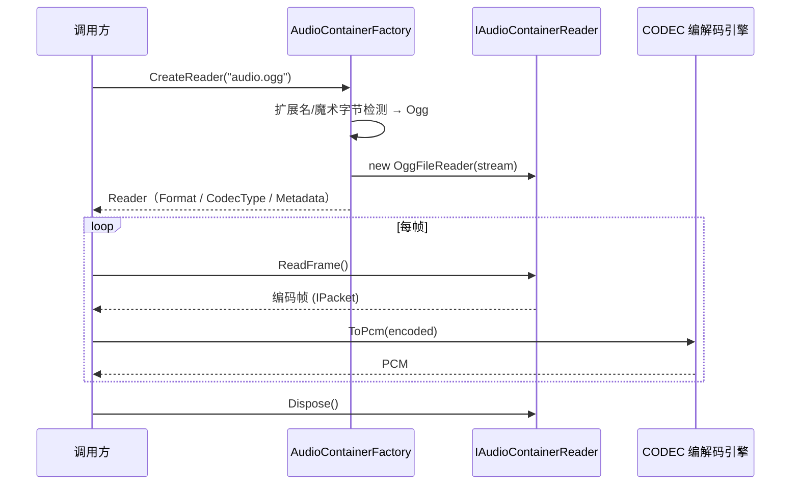
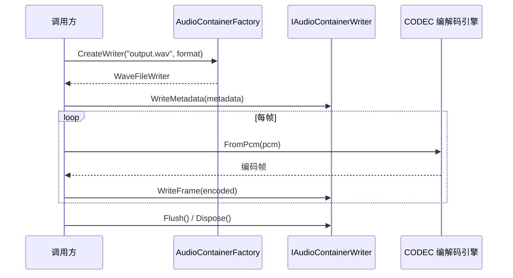
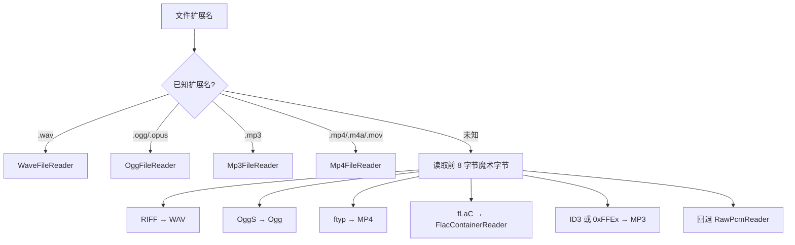

# CONT-容器格式

> 版本：v1.2 | 日期：2026-10-26 | [← 返回 README](../README.zh-CN.md) | [English README](../README.md)
> 需求对应：[需求文档](需求文档.md) 第 6 章 | 功能清单：[功能模块清单](功能模块清单.md)

---

## 1. 模块职责

| 职责 | 说明 |
|---|---|
| 音频文件读取 | 解析容器格式（WAV / Ogg / MP4-M4A / FLAC / MP3 / 裸 PCM），提取编码音频数据和格式元数据 |
| 音频文件写入 | 将编码音频数据封装为容器格式并写入头/数据块；当前覆盖 WAV / Ogg / MP4-M4A / MP3（FLAC 无容器写入器，用 `FlacCodec` 整段编码） |
| 流式输出 | `Writers` 命名空间的 `WavStreamWriter` / `OggOpusStreamWriter` / `Mp3StreamWriter` 面向不可 seek 的流（HTTP/WebSocket 边合成边写） |
| 格式自动识别 | 按扩展名或魔术字节自动选择读写器 |
| 元数据管理 | MP3（ID3v2.4/v1.1）与 Ogg Opus（OpusTags）可读写；WAV 与 MP4 的 `WriteMetadata` 目前为占位 |

> 已知限制：WAV 解析只覆盖标准 44 字节头，不支持 `WAVE_FORMAT_EXTENSIBLE`、IEEE float、RF64 与 `LIST/INFO` 标签（见[架构设计](架构设计.md) FIX-007）；FLAC 只有读取器。

---

## 2. 核心组件

| 组件 | 说明 |
|---|---|
| `IAudioContainerReader` | 容器读取器接口：`Format` / `CodecType` / `TotalFrames` / `Duration` / `Metadata` 属性 + `ReadFrame()` / `SeekFrame()`，实现 `IDisposable` |
| `IAudioContainerWriter` | 容器写入器接口：`Format` 属性 + `WriteMetadata()` / `WriteFrame()` / `Flush()`，实现 `IDisposable` |
| `AudioContainerFactory` | 容器工厂：`CreateReader(path)` / `CreateReader(stream, hint)` / `CreateWriter(path, format)` / `CreateWriter(stream, hint, format)`；写出支持 `.wav` / `.ogg` / `.opus` / `.mp3` / `.mp4` / `.m4a` |
| `WaveFileReader` / `WaveFileWriter` | WAV 容器读写器（只覆盖标准 44 字节头；写入为流式头 + 结束回填） |
| `OggFileReader` / `OggFileWriter` | Ogg 容器读写器（Vorbis + Opus；OpusHead/OpusTags、lacing、granule/pre-skip 按 RFC 7845；Vorbis identification/comment/setup 独立头页由 `WriteVorbisHeaders` 写入） |
| `Mp4FileReader` / `Mp4FileWriter` | MP4/M4A 容器读写器（ISO BMFF 基础盒子 + `esds`；无编辑列表/章节，元数据写入为占位） |
| `Mp3FileReader` / `Mp3FileWriter` | MP3 文件读写器：ID3v2 标签 + 帧索引 + Xing/Info/VBRI 信息帧解析（帧数/字节数）；写入支持帧透传与 PCM 压缩 |
| `Mp3Id3Tag` | ID3v2.3/v2.4 标签解析与 v2.4（UTF-8）标签生成；ID3v1/v1.1 尾标签读写（含 80 项流派表），读取时 ID3v2 优先于 ID3v1 |
| `FlacContainerReader` | FLAC 原生容器**读取器**（fLaC 元数据块、STREAMINFO）；无对应写入器 |
| `RawPcmReader` | 原始 PCM 解析器：按调用方给定的采样率/位深/声道/帧长切帧（自动推断尚未实现） |
| `AudioMetadata` | 音频元数据模型（标题、艺术家、专辑、时长、码率等） |
| `WavStreamWriter` / `OggOpusStreamWriter` / `Mp3StreamWriter` | 面向不可 seek 流的流式写入器（`Writers` 命名空间），由 TTS 与实时推流使用 |

---

## 3. 关键流程

### 3.1 文件读取流程



### 3.2 文件写入流程



### 3.3 格式自动识别流程



---

## 4. 接口/数据结构

### 4.1 核心接口

```csharp
/// <summary>容器读取器接口</summary>
public interface IAudioContainerReader : IDisposable
{
    /// <summary>音频格式</summary>
    AudioFormat Format { get; }

    /// <summary>编码类型</summary>
    AVTypes CodecType { get; }

    /// <summary>总帧数（未知时为 0）</summary>
    Int64 TotalFrames { get; }

    /// <summary>总时长（秒）</summary>
    Double Duration { get; }

    /// <summary>音频元数据</summary>
    AudioMetadata Metadata { get; }

    /// <summary>读取下一帧编码数据</summary>
    /// <returns>编码后的音频帧，流结束返回 null</returns>
    IPacket ReadFrame();

    /// <summary>定位到指定帧</summary>
    void SeekFrame(Int64 frameIndex);
}

/// <summary>容器写入器接口</summary>
public interface IAudioContainerWriter : IDisposable
{
    /// <summary>音频格式</summary>
    AudioFormat Format { get; }

    /// <summary>写入元数据</summary>
    void WriteMetadata(AudioMetadata metadata);

    /// <summary>写入一帧编码数据</summary>
    void WriteFrame(ReadOnlySpan<Byte> encodedFrame);

    /// <summary>完成写入（写入尾部索引等）</summary>
    void Flush();
}
```

### 4.2 数据结构

```csharp
/// <summary>音频元数据</summary>
public class AudioMetadata
{
    public String Title { get; set; }
    public String Artist { get; set; }
    public String Album { get; set; }
    public String Genre { get; set; }
    public Int32 TrackNumber { get; set; }
    public Int32 Year { get; set; }
    public String Comment { get; set; }
    public Byte[] CoverImage { get; set; }
    public String CoverImageMimeType { get; set; }
}
```

### 4.3 WAV 文件结构

```
RIFF Header (12 bytes)
├── "RIFF" (4 bytes)
├── File Size - 8 (4 bytes, LE)
├── "WAVE" (4 bytes)
fmt  Chunk (24 bytes)
├── "fmt " (4 bytes)
├── Chunk Size = 16 (4 bytes, LE)
├── Audio Format = 1 (PCM) (2 bytes)
├── Channels (2 bytes)
├── Sample Rate (4 bytes)
├── Byte Rate (4 bytes)
├── Block Align (2 bytes)
├── Bits Per Sample (2 bytes)
data Chunk
├── "data" (4 bytes)
├── Data Size (4 bytes, LE)
└── PCM/编码数据...
```

---

## 5. 设计决策

| 决策 | 理由 |
|---|---|
| 容器与编解码分离 | 容器只负责解析/封装，编码数据交给 CODEC 处理，职责清晰 |
| 读取器不自动解码 | 调用方按需选择解码或不解码（如仅需转发编码数据），灵活性最高 |
| `RawPcmReader` 需要显式参数 | 无头 PCM 没有任何可靠的自描述信息，盲猜采样率/位深/声道极易出错；当前要求调用方给出参数（自动推断待后续按场景补齐） |
| 元数据与音频数据分离 | 写入时元数据可提前设置，不与帧数据混在一起 |
| Ogg 容器同时支持 Vorbis 和 Opus | Ogg 是 Opus 的标准容器（RFC 7845），一石二鸟 |
| Ogg Opus granule = pre-skip + 累计 48 kHz 样本 | 与 RFC 7845 的 PCM sample position 定义一致，浏览器 MSE 可正确 seek；包时长由 TOC 解析而非固定 20 ms |
| Ogg Opus pre-skip 默认 0，本地编码取 `OpusCodec.GetLookahead(options)` | 预跳应等于编码器延迟；外部已编码流未知时取 0 比固定 80 ms 更安全，避免丢弃真实音频 |
| Ogg Vorbis 头包按页拆分 | identification 单独一页，comment 与 setup 各自成页，避免多包同页导致部分解码器只读第一个头包 |
| Ogg Vorbis 首音频包 granule=0 | 首包只建立重叠状态，不产生 PCM；后续页按 hop 累计，读取器按最后 granule 裁剪尾部 padding |
| Ogg 读取器暴露 `PreSkip` / `TotalSamples` / `Duration` | 播放器可据此裁剪 Opus 预跳与尾部 padding，与 RFC 7845 的 PCM sample position 对齐 |

---

（完）
