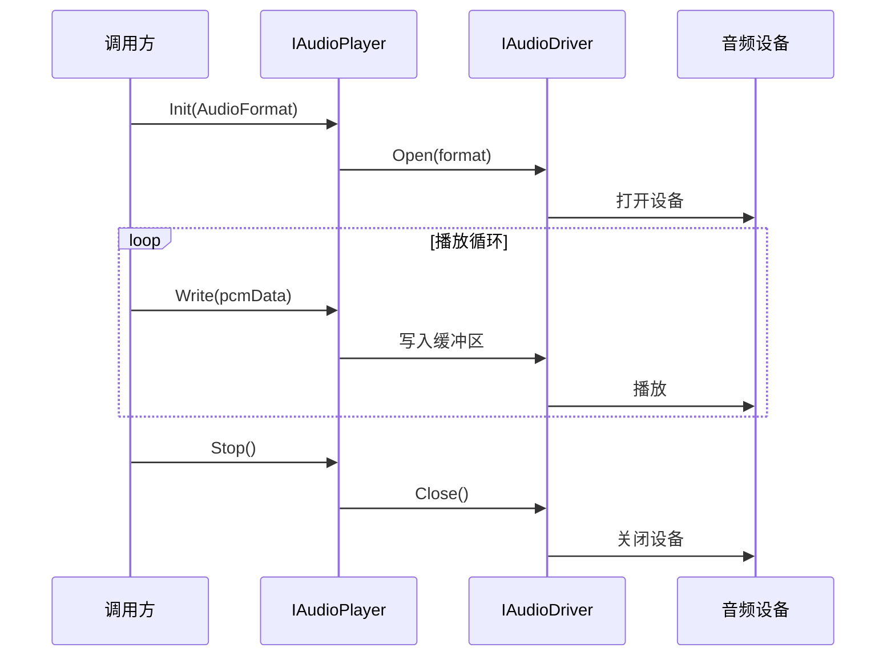
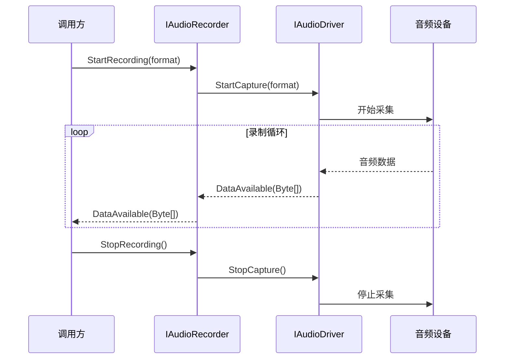
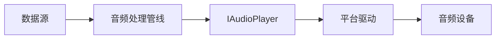

# DEVIO-音频设备IO

> 版本：v1.4 | 日期：2026-10-26 | [← 返回 README](../README.zh-CN.md) | [English README](../README.md)
> 需求对应：[需求文档](需求文档.md) 第 3 章 | 功能清单：[功能模块清单](功能模块清单.md)

---

## 1. 模块职责

| 职责 | 说明 |
|---|---|
| 设备发现 | 枚举系统音频输入/输出设备，获取名称、通道数、格式支持等元数据 |
| 音频播放 | 将 PCM/编码数据推送到音频输出设备 |
| 音频录制 | 从音频输入设备采集原始 PCM 数据 |
| 驱动适配 | 目标平台：Windows（WaveOut/WASAPI/ASIO）、Linux（ALSA）、macOS（CoreAudio）、Android（AAudio）、iOS（AVAudioEngine）；**Windows WaveOut/WaveIn（WinMM）与 WASAPI 为完整实现**，Linux ALSA 已落地（🟡 待 Linux 真机验证），ASIO 明确不支持，macOS/移动端未开始 |
| 生命周期管理 | 播放/录制会话的启停、暂停、恢复、缓冲区管理 |

---

## 2. 核心组件

| 组件 | 说明 |
|---|---|
| `AudioDeviceManager` | 设备管理器：驱动注册、设备枚举、默认设备选择、播放器/录制器创建 |
| `AudioDriverFactory` | 驱动工厂：`Create()` 按运行时平台选择（Windows 默认 WinMM，Linux 且能加载 `libasound.so.2` 时返回 `AlsaDriver`，其余返回 `UnsupportedDriver`）；`Create(name)` 可显式指定 waveout / wasapi / asio / alsa；`IsSupported` 与 `GetAvailableBackends()` 上报能力；无可用后端时返回 `UnsupportedDriver`，创建播放/录制器时抛 `PlatformNotSupportedException`（FIX-005 已修） |
| `IAudioPlayer` | 播放器接口：`Play()`/`Pause()`/`Stop()`/`Init(AudioFormat)` |
| `IAudioRecorder` | 录音器接口：`StartRecording()`/`StopRecording()`/`DataAvailable` 事件 |
| `IAudioDriver` | 音频驱动统一接口：枚举设备、创建播放器/录制器 |
| `AudioFormat` | 音频格式描述：采样率、位深、声道数、编码类型 |
| `WaveOutNativeDriver` | Windows WaveOut API 驱动实现（WaveOut 播放 + WaveIn 录制，真实 P/Invoke） |
| `WasapiDriver` | WASAPI 真实实现：`IMMDeviceEnumerator` + `IPropertyStore` 枚举端点并读取友好名称；`IAudioClient` 共享模式播放/采集；渲染端点加 `AUDCLNT_STREAMFLAGS_LOOPBACK` 回采；支持事件回调低延迟（20 ms 缓冲，失败回落轮询）与设备丢失后在新默认设备重连（`ReconnectCount`） |
| `AsioDriver` | 明确未实现：`EnumerateDevices` 返回空，`CreatePlayer`/`CreateRecorder` 抛 `NotSupportedException`；需 ASIO SDK 后立项 |
| `AlsaDriver` | Linux ALSA：`snd_device_name_hint` 枚举 PCM 设备，`snd_pcm_open` + `snd_pcm_set_params`（S16_LE 交错）后 `snd_pcm_writei`/`snd_pcm_readi` 播放与采集，xrun（`-EPIPE`/`-ESTRPIPE`）重新 `prepare` 后重试；`IsAvailable` 在非 Linux 或加载不到 `libasound.so.2` 时为 false，此时枚举返回空、默认设备返回 null、`Init` 抛 `NotSupportedException`。**尚未在真实 Linux 声卡验证** |
| `LoopbackRecorder` | 系统音频回路录制：走 WASAPI loopback 真实回采，按请求格式转换 |
| `AudioDeviceWatcher` | 经 `IMMNotificationClient` 上报设备增删、状态变化与默认设备切换，并提供活动端点快照 |
| `AudioDeviceInfo` | 音频设备元数据：名称、ID、输入/输出、支持格式 |

---

## 3. 关键流程

### 3.1 播放流程



### 3.2 录制流程



### 3.3 播放器 + 信号链整合（与 DSP 协同）



---

## 4. 接口/数据结构

### 4.1 核心接口

```csharp
/// <summary>音频格式描述</summary>
public class AudioFormat
{
    public Int32 SampleRate { get; set; } = 8000;
    public Int32 Channels { get; set; } = 1;
    public Int32 BitsPerSample { get; set; } = 16;
    public Boolean IsFloat { get; set; }
    public SampleFormat SampleFormat => PcmConverter.FromBits(BitsPerSample, IsFloat);
    public AVTypes Encoding { get; set; } = AVTypes.LPCM;
    public Int32 SamplesPerFrame { get; set; } = 160;
    public Int32 ByteRate => SampleRate * Channels * BitsPerSample / 8;
    public Int32 BytesPerSample => BitsPerSample / 8;
    public Int32 BytesPerFrame => SamplesPerFrame * Channels * BytesPerSample;
}

/// <summary>音频设备信息</summary>
public class AudioDeviceInfo
{
    public String Id { get; set; }
    public String Name { get; set; }
    public Boolean IsInput { get; set; }
    public Boolean IsDefault { get; set; }
    public List<AudioFormat> SupportedFormats { get; set; } = [];
}

/// <summary>音频播放器接口</summary>
public interface IAudioPlayer : IDisposable
{
    void Init(AudioFormat format, String deviceId = null);
    void Play();
    void Pause();
    void Stop();
    void Write(Byte[] data);
    Int32 BufferedBytes { get; }
    event EventHandler PlaybackStopped;
}

/// <summary>音频录制器接口</summary>
public interface IAudioRecorder : IDisposable
{
    void Init(AudioFormat format, String deviceId = null);
    void StartRecording();
    void StopRecording();
    event EventHandler<Byte[]> DataAvailable;
}
```

### 4.2 音频驱动

```csharp
/// <summary>音频驱动接口。一个驱动对应一套平台 API</summary>
public interface IAudioDriver
{
    String Name { get; }
    IReadOnlyList<AudioDeviceInfo> EnumerateDevices();
    AudioDeviceInfo GetDefaultOutputDevice();
    AudioDeviceInfo GetDefaultInputDevice();
    IAudioPlayer CreatePlayer();
    IAudioRecorder CreateRecorder();
}
```

---

## 5. 设计决策

| 决策 | 理由 |
|---|---|
| 驱动适配器模式 | 不同平台/API 差异巨大，适配器模式隔离变化，核心接口保持稳定 |
| 同步 `Write()` + 异步事件 `DataAvailable` | 播放是调用方主动推送（同步写），录制是被动接收（事件回调），符合各自语义 |
| `AudioFormat` 包含 `AVTypes` | 支持编码音频直接播放（如 G.711 设备输出），不只是原始 PCM |
| 驱动按运行时平台选择（已落地） | 用 `Environment.OSVersion.Platform` 判断，与编译目标框架无关；Windows 用 WinMM，Linux 在能加载 `libasound.so.2` 时用 ALSA；无可用后端返回 `UnsupportedDriver` 并明确抛 `PlatformNotSupportedException`，不再返回假设备（FIX-005） |
| WASAPI 事件回调 + 轮询回退 | 事件驱动可降低延迟；事件句柄不可用时自动回落到 100 ms 轮询，保证兼容性 |
| 设备丢失后在新默认设备重连 | 播放/采集循环检测 `AUDCLNT_E_DEVICE_INVALIDATED` 后释放端点并重开，`ReconnectCount` 可观测 |
| 优先平台原生 API | 不用第三方跨平台抽象库（增加原生依赖），直接调用 OS API，零依赖 |
| 跨平台原生驱动进入路线图 | 原"Linux/macOS 暂缓"的结论已调整：五平台（含 Android/iOS）设备 I/O 纳入阶段一/二，见[架构设计](架构设计.md) 路线图 |
| 驱动命名（v1.2 破坏性） | `IAudioBackend`/`AudioBackendFactory` 与三个 Backend 实现直接改名为 Driver，不保留 Obsolete 别名；旧调用方需替换类型名，API 兼容门禁会报告这些删除 |

---

（完）
