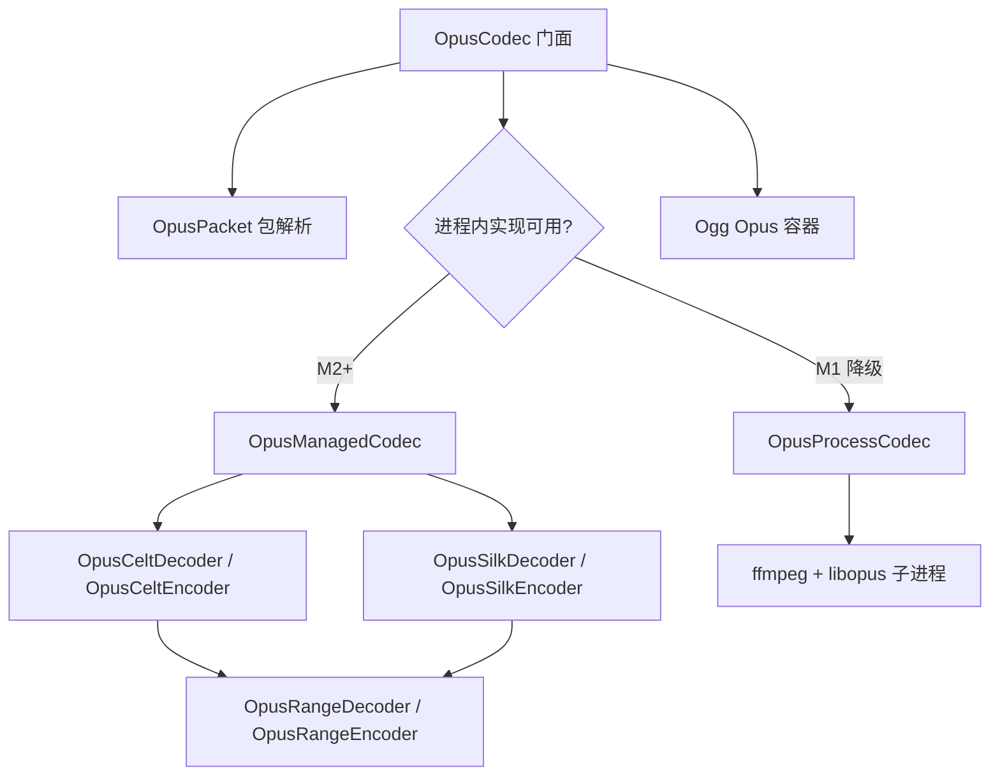

# OPUS-自研编解码

> 版本：v0.1 | 日期：2026-10-26 | [← 返回 README](../README.zh-CN.md)
> 需求对应：[需求文档](需求文档.md) CODEC-5 | 功能清单：[功能模块清单](功能模块清单.md)

---

## 1. 目标与约束

| 约束 | 决策 |
|---|---|
| 第三方依赖 | 不引入任何 NuGet 编解码包 |
| 原生依赖 | 优先纯托管；不使用 P/Invoke 调用 libopus |
| 操作系统能力 | 仅作为降级方案，通过子进程调用系统 ffmpeg（libopus） |
| 平台 | Windows / Linux / macOS |
| 语言与性能 | C# 14、`Span<T>`、`ref struct`、无分配解析；实时路径避免反射与复杂 LINQ |
| 互操作 | 以 RFC 6716 / RFC 7845 为准，输出可被标准 Opus 解码器识别 |
| 参考实现 | 可参考 MIT 许可的 Opus 实现理解算法，但按 NewLife 风格独立重写，不照搬代码 |

> 完整 Opus 包含 SILK（语音）、CELT（音乐/低延迟）与 Hybrid 三层，参考实现约 2 万行 C 代码。本项目按里程碑推进，**不承诺单次交付完整双向编解码**。

---

## 2. 当前状态（M1）

| 能力 | 状态 | 说明 |
|---|---|---|
| Opus 包结构解析 | ✅ | `OpusPacket` 完整解析 TOC、Code 0~3、帧数、帧长、VBR/CBR、padding、120 ms 上限 |
| 包头部兼容层 | ✅ | `OpusPacketHeader` 保持既有公共 API，内部改为自研解析器 |
| 范围编码器/解码器 | ✅ 基础 | `OpusRangeEncoder` / `OpusRangeDecoder` 按 RFC 6716 §4.1/§5.1 实现，含符号、二进制、ICDF、整数、raw bits；已通过内部往返测试，标准向量逐位校验随 M2 CELT 完成 |
| Ogg Opus 容器 | ✅ | `OggFileReader` / `OggFileWriter` / `OggOpusStreamWriter`，CRC、lacing、pre-skip、granule、EOS 已修复 |
| OS 进程回退 | ✅ | `OpusProcessCodec` 调用 ffmpeg + libopus，支持全部合法采样率/声道/帧长 |
| CELT 解码 | ⏳ M2 | 尚未实现 |
| CELT 编码 | ⏳ M3 | 尚未实现 |
| SILK 解码 | ⏳ M4 | 尚未实现 |
| SILK 编码 | ⏳ M5 | 尚未实现 |
| FEC / DTX / PLC | ⏳ M4~M5 | 进程回退不支持，相关测试暂时 Skip |

---

## 3. 分层架构



### 3.1 模块职责

| 模块 | 职责 |
|---|---|
| `OpusCodec` | 公共门面：选项校验、帧缓冲、包输出、pre-skip/lookahead；优先进程内实现，否则进程回退 |
| `OpusPacket` | 零分配解析 TOC/Code/帧边界/padding；`ref struct` + `ReadOnlySpan<Byte>` |
| `OpusManagedCodec` | 进程内托管编解码切换点；M1 返回不可用，M2 起按 CELT/SILK 能力逐步开启 |
| `OpusRangeDecoder` | 范围解码状态机；提供 `Decode/Update`、`DecodeBitLogp`、`DecodeICdf`、`DecodeUInt`、`DecodeBits` |
| `OpusRangeEncoder` | 范围编码状态机；与解码器对称，含进位传播与 raw bits 尾部写入 |
| `OpusProcessCodec` | 操作系统降级：ffmpeg 探测、Ogg 封装/解封装、stdin/stdout PCM 管道 |
| `OggOpusStreamWriter` | 单包 → Ogg 页；供进程回退与流式输出共用 |

### 3.2 设计要点

- **包解析与音频解码解耦**：即使 CELT/SILK 尚未完成，RTP/Ogg/容器层仍可正确切包、计算时长与 granule。
- **范围编码器独立可测**：不依赖 CELT 表即可做符号级往返测试，为后续 CELT/SILK 提供可信基础。
- **进程回退不作为默认长期方案**：每帧启动一次 ffmpeg，延迟与 CPU 开销高；只用于 M1 可用性与互操作兜底。
- **pre-skip**：libopus 固定算法延迟 6.5 ms；`OpusCodec.GetLookahead` 按采样率换算（48 kHz = 312，16 kHz = 104）。

---

## 4. 里程碑

| 里程碑 | 交付物 | 验收标准 |
|---|---|---|
| **M1 基础与降级** | `OpusPacket`、`OpusRangeEncoder/Decoder`、`OpusProcessCodec`、Ogg 修复、设计文档 | 包解析覆盖 Code 0~3；范围编码器往返测试通过；有 ffmpeg 时全采样率/帧长/声道往返；无 ffmpeg 时抛出清晰 `NotSupportedException` |
| **M2 CELT 解码** | `OpusCeltDecoder`、MDCT/窗函数、频带能量、PVQ 解码、去叠混 | 解码 libopus 生成的 CELT-only 包，与 ffmpeg 输出逐样本误差在阈值内；支持 2.5~20 ms |
| **M3 CELT 编码** | `OpusCeltEncoder`、比特分配、PVQ 搜索、熵编码 | 输出可被 ffmpeg/libopus 解码；48 kHz 单/双声道 20 ms 正弦与语音样本相关度达标 |
| **M4 SILK 解码** | `OpusSilkDecoder`、LPC/LTP、脉冲解码、重采样、PLC/FEC | 解码 libopus SILK/Hybrid 包；FEC 与 PLC 测试启用 |
| **M5 SILK 编码** | `OpusSilkEncoder`、语音活动检测、DTX、码率控制 | 输出可被标准解码器识别；DTX 静音包测试启用 |
| **M6 性能与互操作** | SIMD/池化优化、AOT 冒烟、互操作矩阵、文档 | 实时因子达标；Windows/Linux/macOS + NativeAOT 通过；与 ffmpeg 双向互操作 |

---

## 5. 操作系统降级方案

### 5.1 探测顺序

1. 环境变量 `OPUS_FFMPEG` 指向的可执行文件；
2. `PATH` 中的 `ffmpeg`（Windows 自动尝试 `ffmpeg.exe`）；
3. 运行 `ffmpeg -encoders` 确认存在 `libopus`，运行 `-decoders` 确认存在 `opus`。

探测结果缓存；切换环境变量后调用 `OpusProcessCodec.ResetAvailability()`。

### 5.2 编解码管道

**解码（单包 → PCM）**

```text
Opus 包
  → OggOpusStreamWriter 封装为最小 Ogg Opus 流（pre-skip = 0）
  → ffmpeg -i pipe:0 -f s16le -ar {rate} -ac {channels} pipe:1
  → 16-bit 小端交错 PCM
```

**编码（一帧 PCM → 单包）**

```text
16-bit 小端 PCM
  → ffmpeg -f s16le -ar {rate} -ac {channels} -i pipe:0
           -c:a libopus -b:a {bitrate} -application {app}
           -frame_duration {ms} -vbr {on|off|constrained}
           -compression_level {complexity} -f ogg pipe:1
  → OggFileReader 提取首个 Opus 包
```

### 5.3 限制

- 每帧一次子进程，吞吐量低；实时/批量场景应等待 M2~M5。
- 进程回退不实现 FEC、DTX、PLC；相关 API 返回空包或忽略选项。
- 依赖外部 ffmpeg 的 libopus 构建；部分最小化构建可能缺少 `libopus`。
- 不复制 ffmpeg 二进制，不改变用户环境。

---

## 6. 测试矩阵

| 层级 | 测试 | 是否依赖 ffmpeg |
|---|---|---|
| 包解析 | Code 0/1/2/3、CBR/VBR、padding、非法长度、120 ms 上限 | 否 |
| 范围编码 | 符号/二进制/ICDF/整数/raw bits 往返、空流、非法参数 | 否 |
| Ogg 容器 | CRC 向量、lacing 255、EOS 空页、pre-skip/granule、跨页重组 | 否 |
| 进程往返 | 单/双声道、全部合法采样率、全部帧长、多帧/flush | 是（条件执行） |
| 互操作 | 本库输出由 ffmpeg 解码；ffmpeg 输出由本库解码 | 是 |
| AOT | `AotSmoke` 包解析场景，不依赖外部进程 | 否 |

> 单元测试在无 ffmpeg 环境下仍应全绿：进程相关用例在 `OpusProcessCodec.IsAvailable == false` 时直接返回。

---

## 7. 风险与对策

| 风险 | 影响 | 对策 |
|---|---|---|
| CELT 表与比特分配复杂 | 解码不一致、噪声 | 先实现范围编码器并用标准向量校验；按模块增量对比 ffmpeg 输出 |
| SILK 状态机与重采样复杂 | 语音质量差、延迟漂移 | 分 M4/M5 两步；先解码后编码；以 8/16 kHz 语音样本为主 |
| 浮点与整数路径差异 | 跨平台不一致 | 关键路径使用整数/定点；浮点仅用于 MDCT 等允许误差模块 |
| 进程回退性能差 | 实时场景不可用 | 明确标注为过渡方案；M2 后优先托管解码 |
| 无第三方包导致进度慢 | 交付周期长 | 里程碑交付；每阶段保持可编译、可测试、可回退 |

---

## 8. 参考与许可

- **规范**：RFC 6716（Opus）、RFC 7845（Ogg Opus）、RFC 3533（Ogg）。
- **参考实现**：libopus / opusfile（BSD 许可）用于理解算法与互操作验证；Concentus（MIT）可作为 C# 结构参考。
- **独立性**：不复制参考实现代码；所有模块按 NewLife 命名、注释、`Span<T>` 与异常处理规范重写。
- **许可证**：本库保持 MIT；不引入 GPL/专利受限代码。

---

（完）
