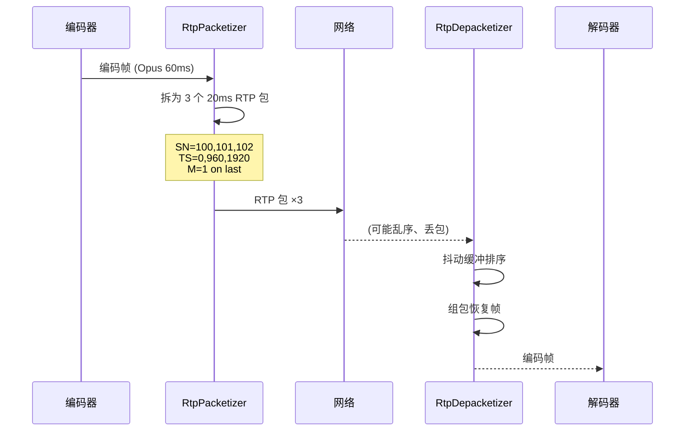
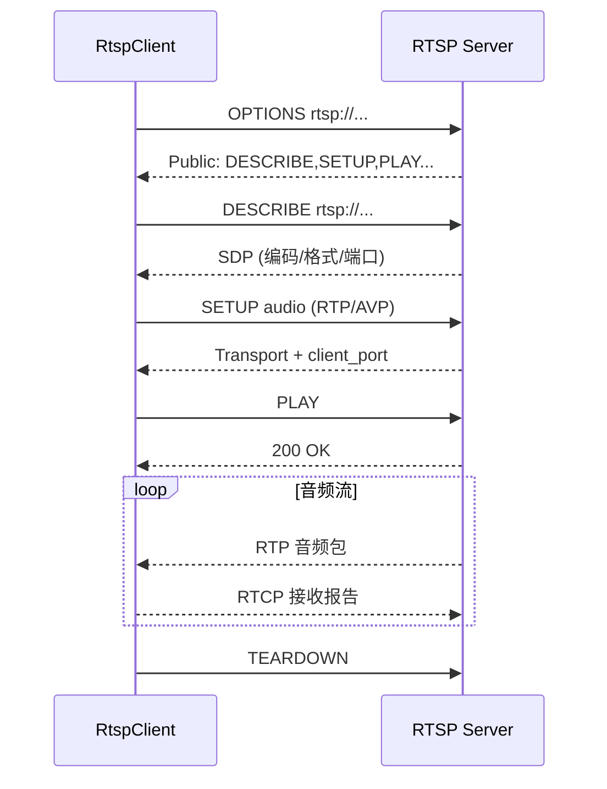
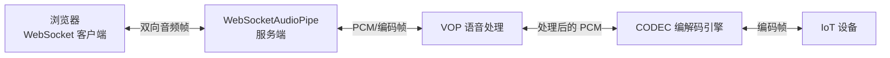

# STRM-流媒体传输

> 版本：v1.2 | 日期：2026-10-26 | [← 返回 README](../README.zh-CN.md) | [English README](../README.md)
> 需求对应：[需求文档](需求文档.md) 第 8 章 | 功能清单：[功能模块清单](功能模块清单.md)

> ✅ 本模块全部 4 项功能已实现，详见[功能模块清单](功能模块清单.md)。

---

## 1. 模块职责

| 职责 | 说明 |
|---|---|
| RTP 封包与解包 | 按 RFC 3550 将音频帧封装为 RTP 包，或从 RTP 包中解析音频帧；AAC 走 RFC 3640 的 AU Header 分片 |
| 流媒体客户端 | RTSP/HTTP 流拉取，支持连接、播放、断开等生命周期 |
| WebSocket 实时传输 | 基于 WebSocket 的低延迟双向音频管道，服务 Web 端对讲场景 |
| 抖动缓冲 | 网络接收端缓冲管理，平滑网络抖动，保证连续播放 |

---

## 2. 核心组件

| 组件 | 说明 |
|---|---|
| `RtpPacket` | RTP 包数据结构：头部字段（V/P/X/CC/M/PT/SN/TS/SSRC/CSRC） + 载荷 |
| `RtpPacketizer` | RTP 封包器：音频帧 → 一个或多个 RTP 包（分片） |
| `RtpDepacketizer` | RTP 解包器：RTP 包 → 音频帧（组包） |
| `AacRtpPacketizer` / `AacRtpDepacketizer` | AAC 的 RFC 3640（AAC-hbr + AU Header）分片与重组 |
| `RtpSession` | RTP 会话管理：SSRC、序列号、时间戳递增 |
| `RtspClient` | RTSP 客户端：OPTIONS/DESCRIBE/SETUP/PLAY/TEARDOWN 协议交互（仅客户端，无服务端） |
| `JitterBuffer` | 抖动缓冲：可配置延迟窗口，排序、去重、丢包统计 |
| `HttpAudioStreamSource` | Icecast/SHOUTcast 风格 HTTP 音频流拉取 |
| `WebSocketAudioPipe` | WebSocket 音频管道：封装音频帧为 WebSocket 消息，双向传输 |

---

## 3. 关键流程

### 3.1 RTP 封包与解包流程



### 3.2 RTSP 拉流流程



### 3.3 WebSocket 实时对讲流程



---

## 4. 接口/数据结构

### 4.1 RTP 包结构

```csharp
/// <summary>RTP 包</summary>
public struct RtpPacket
{
    // 固定头部
    public Byte Version;              // 2
    public Boolean Padding;
    public Boolean Extension;
    public Byte CsrcCount;
    public Boolean Marker;
    public Byte PayloadType;          // 0=PCMU, 8=PCMA, 96=Opus, 97=AAC...
    public UInt16 SequenceNumber;
    public UInt32 Timestamp;
    public UInt32 Ssrc;
    public UInt32[] CsrcList;

    // 载荷
    public Byte[] Payload;

    /// <summary>序列化为网络字节序</summary>
    public Byte[] ToBytes();

    /// <summary>从网络字节序反序列化</summary>
    public static RtpPacket FromBytes(Byte[] data);
}
```

### 4.2 抖动缓冲

```csharp
/// <summary>抖动缓冲。排序、去重、丢包统计</summary>
public class JitterBuffer
{
    public JitterBuffer(Int32 maxDelayMs = 60, Int32 packetIntervalMs = 20);

    /// <summary>缓冲区大小（包数）</summary>
    public Int32 BufferSize { get; }

    /// <summary>当前延迟（毫秒）</summary>
    public Double CurrentDelayMs { get; }

    /// <summary>丢包率</summary>
    public Double LossRate { get; }

    /// <summary>写入一个 RTP 包</summary>
    public void Write(UInt16 sequenceNumber, Byte[] payload, UInt32 timestamp);

    /// <summary>按序取出一个包；暂无可用包时返回 false</summary>
    public Boolean Read(out Byte[] payload);

    public void Reset();
}
```

### 4.3 RTSP 客户端

```csharp
/// <summary>RTSP 客户端（拉流）</summary>
public class RtspClient : IDisposable
{
    public RtspClient(String url);

    public AudioFormat AudioFormat { get; }
    public AVTypes CodecType { get; }
    public Boolean IsConnected { get; }

    public Task ConnectAsync(CancellationToken ct = default);
    public Task<String> OptionsAsync(CancellationToken ct = default);
    public Task<String> DescribeAsync(CancellationToken ct = default);
    public Task<Boolean> SetupAsync(String transport = "RTP/AVP/TCP;interleaved=0-1", CancellationToken ct = default);
    public Task<Boolean> PlayAsync(String range = "npt=0-", CancellationToken ct = default);
    public Task<Boolean> PauseAsync(CancellationToken ct = default);
    public Task TeardownAsync(CancellationToken ct = default);

    /// <summary>接收到音频帧（编码后负载）</summary>
    public event EventHandler<IPacket> AudioFrameReceived;
}
```

---

## 5. 设计决策

| 决策 | 理由 |
|---|---|
| RTP 封包/解包独立于传输层 | RTP 只定义包格式，不绑定承载方式（UDP/TCP/WebSocket），可复用 |
| RTSP 使用 NewLife.Net 的 TCP 能力 | 复用 NewLife 现有网络基础设施（`NetClient`/`NetServer`），避免重复造轮子 |
| WebSocket 使用 NewLife.Http 的 WebSocket 支持 | 复用 `WebSocketSession` / `WebSocketClient` |
| 抖动缓冲可配置 | 实时对讲（20-60ms 缓冲）vs 单向广播（200-500ms 缓冲），场景差异大 |
| RTCP 简化为基本接收报告 | 完整 RTCP 协议复杂，初期仅需丢包率和抖动统计 |
| 远端实施优先级 | RTP 封包 > RTSP 客户端 > WebSocket > HTTP 流 |

---

（完）
