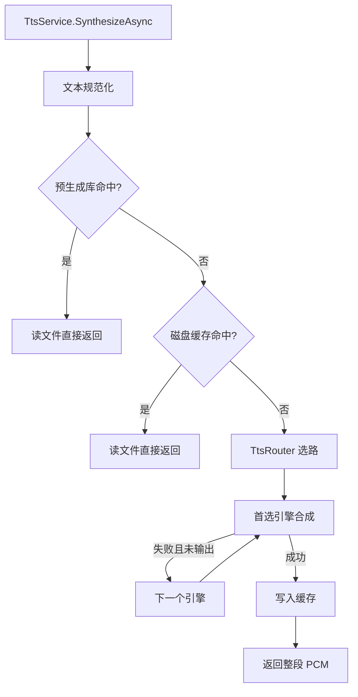
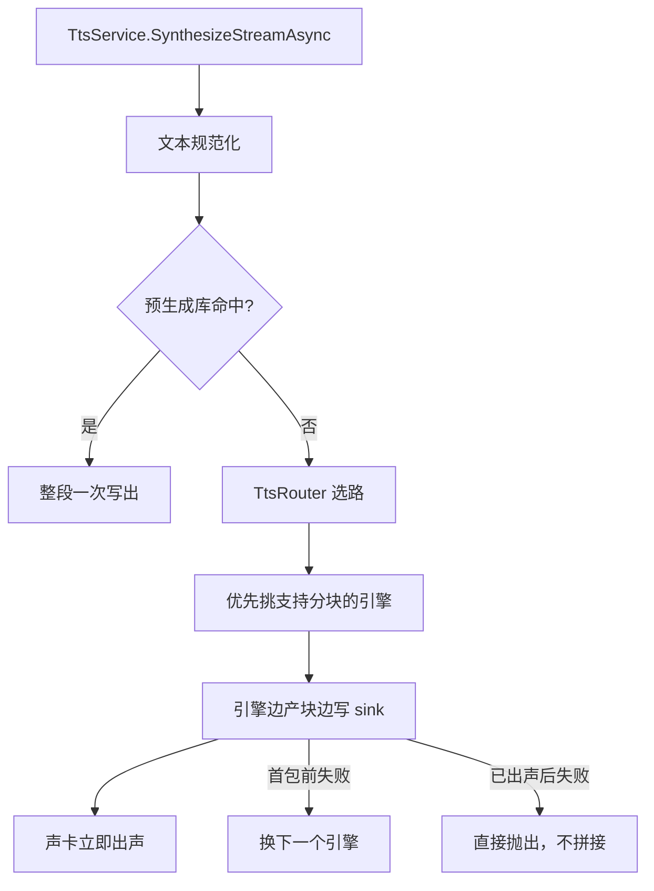
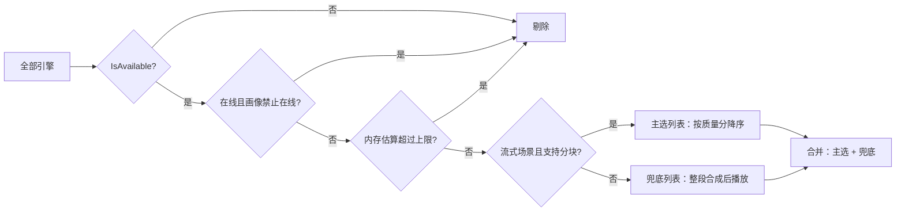

# TTS-语音合成

> 版本：v1.1 | 日期：2026-10-25 | [← 返回 README](../README.zh-CN.md) | [English README](../README.md)
> 需求对应：[需求文档](需求文档.md) 第 8 章 | 功能清单：[功能模块清单](功能模块清单.md)

> 🟡 本模块 15 项功能中 12 项已实现（含 43 个单元测试），TTS-13/14/15 待有落地场景后接入，详见[功能模块清单](功能模块清单.md)。

---

## 1. 模块职责

| 职责 | 说明 |
|---|---|
| 引擎抽象 | 用统一接口覆盖离线神经模型、子进程工具、在线服务三类合成能力，上层不感知差异 |
| 场景编排 | 按“完整 / 流式”两种使用方式组织预生成、缓存、合成与降级 |
| 文本规范化 | 把阿拉伯数字、英文单词、全角字符、空白转成声学模型能读对的形式 |
| 结果复用 | 内容哈希缓存 + 预生成库，把握手级延迟压到文件读取级 |
| 环境适配 | 按 PC / 嵌入式 / 服务器的内存与网络约束挑选可用引擎 |
| 音频交付 | 输出标准 16 位 PCM，可直接接 DEVIO 播放、CODEC 编码、CONT 容器封装 |

**边界**：本模块只做“合成编排”，不做模型训练，也不内置模型权重与推理运行时。离线神经模型通过适配器接入（可选包或调用方自行集成），核心库仍是纯托管、零原生依赖、NativeAOT 就绪。

---

## 2. 核心组件

| 组件 | 说明 |
|---|---|
| `ITtsEngine` / `TtsEngineBase` | 合成引擎接口与基类：名称、能力位、质量分、内存估算、可用性、合成方法 |
| `ITtsSink` / `TtsBufferSink` / `TtsDelegateSink` | 分块输出目标：攒成整段 或 直接回调给播放器 |
| `TtsRequest` / `TtsResult` | 合成请求与结果，含场景、来源、首包耗时、实时率、降级链 |
| `TtsCapability` / `TtsScenario` / `TtsTarget` / `TtsSource` / `TtsNumberMode` | 能力位与场景枚举 |
| `TtsText` / `ChineseNumber` | 文本规范化与中文数字读法 |
| `TtsCache` | 内容哈希磁盘缓存，原子写入 + 最近最少使用淘汰 |
| `TtsPreGenerated` | 预生成语音库，与缓存共用键，运行时直接命中 |
| `TtsRuntimeProfile` | 运行画像：内存上限、在线开关、网络状态，含三档预设 |
| `TtsRouter` | 选路与降级：按场景过滤排序，逐个尝试，记录尝试链 |
| `TtsService` | 编排入口：规范化 → 预生成 → 缓存 → 合成，两个方法对应两种场景 |
| `NullTtsEngine` | 静音兜底引擎，保证永远有输出 |
| `ProcessTtsEngine` | 子进程引擎，驱动 piper / espeak-ng 等命令行合成器 |
| `HttpTtsEngine` | 在线引擎，可配置请求模板，解码 WAV / MP3 / 裸 PCM |
| `TtsWav` / `TtsWavInfo` | WAV 头解析与流式剥离 |

---

## 3. 关键流程

### 3.1 完整合成（可以等，结果可复用）



### 3.2 流式合成（不能等，边合成边播）



**关键约束**：已经写出去的音频无法撤回，因此“首包之后失败”必须报错而不是换引擎，否则用户会听到两段不同音色的拼接。

### 3.3 选路与降级



硬约束只有“是否允许在线”（合规问题，不可放宽）。内存与流式能力是软约束：优先满足，实在没有就退化——没有流式引擎时退化为整段合成后播放，总比没声音好。

### 3.4 运行时数据流

```
文本 → TtsText.Normalize → 键 = SHA1(引擎|音色|语速|文本)
                              ├─ TtsPreGenerated 命中 → PCM
                              ├─ TtsCache 命中 → PCM
                              └─ ITtsEngine → PCM 块 → ITtsSink → 播放/编码/封装
```

---

## 4. 接口/数据结构

### 4.1 引擎接口

```csharp
public interface ITtsEngine : IDisposable
{
    String Name { get; }
    TtsCapability Capabilities { get; }
    Int32 Quality { get; }
    Int64 RequiredMemoryBytes { get; }
    Boolean IsAvailable { get; }

    Task<TtsResult> SynthesizeAsync(TtsRequest request, ITtsSink sink, CancellationToken cancellationToken);
}
```

`sink` 为 `null` 表示“返回整段 PCM”，非 `null` 表示“边合成边写出” —— 一个方法覆盖两种场景。

### 4.2 输出目标

```csharp
public interface ITtsSink
{
    void Open(AudioFormat format);
    void Write(Byte[] buffer, Int32 offset, Int32 count);
    void Close();
}
```

`TtsDelegateSink` 可直接接到播放器：

```csharp
await service.SynthesizeStreamAsync(request,
    new TtsDelegateSink(fmt => player.Open(fmt), (buf, off, len) => player.Write(buf, off, len), () => player.Drain()));
```

### 4.3 请求与结果

| 字段 | 说明 |
|---|---|
| `TtsRequest.Text` | 待合成文本，服务内部会规范化 |
| `TtsRequest.Voice` | 音色标识，离线为模型/说话人，在线为服务端 voice 参数 |
| `TtsRequest.Speed` | 语速倍率 |
| `TtsRequest.Scenario` | 完整 / 流式，由调用的方法自动设置 |
| `TtsRequest.Normalize` / `NumberMode` | 是否规范化、数字读法策略 |
| `TtsResult.Source` | 预生成 / 缓存 / 实时合成 |
| `TtsResult.PcmBytes` / `Pcm` | 流式只填字节数，完整两者都填 |
| `TtsResult.FirstChunkTime` / `Rtf` | 首包耗时与实时率 |
| `TtsResult.Attempts` | 降级链，排查“为什么用了这个引擎” |

### 4.4 三种内置引擎

| 引擎 | 关键配置 | 能力 | 典型用途 |
|---|---|---|---|
| `ProcessTtsEngine` | `FileName` / `Arguments` 模板 / `OutputKind` / `SampleRate` | 离线 + 流式 | 驱动 piper、espeak-ng |
| `HttpTtsEngine` | `Url` / `Method` / `BodyTemplate` / `Headers` / `ResponseKind` | 在线（WAV/裸 PCM 时带流式） | 对接各家在线合成 |
| `NullTtsEngine` | `SecondsPerChar` | 离线 + 流式 | 兜底、无声卡环境、单元测试 |

### 4.5 运行画像

| 预设 | 内存上限 | 在线 | 适用 |
|---|---|---|---|
| `TtsRuntimeProfile.Embedded` | 384MB | 禁止 | 嵌入式板卡，典型 1GB 内存设备 |
| `TtsRuntimeProfile.Desktop` | 2GB | 允许 | 开发机与 PC |
| `TtsRuntimeProfile.Server` | 不限 | 允许 | 服务器批量合成 |
| `TtsRuntimeProfile.Detect()` | 按机器探测 | 内存 <1GB 时禁止 | 通用入口 |

`ReadAvailableMemory()` 在 Linux 读 `/proc/meminfo` 的 `MemAvailable`，其它平台返回 0 表示未知。

---

## 5. 集成示例

### 5.1 嵌入式：子进程引擎 + 预生成

```csharp
using var service = new TtsService();
service.Router.Profile = TtsRuntimeProfile.Embedded;
service.Router.Register(new ProcessTtsEngine
{
    Name = "piper",
    FileName = "/opt/tts/piper",
    Arguments = "--model /opt/tts/zh_CN-huayan-medium.onnx --output-raw --sentence_silence 0.08",
    SampleRate = 22050,
});
service.Router.Register(new NullTtsEngine());

// 打包进镜像前跑一次，固定告警语从此不再实时合成
await service.PreGenerated.BuildAsync(service.Router.Find("piper"), ["设备离线", "温度过高", "请检查网络"]);
```

### 5.2 桌面/服务器：在线引擎优先

```csharp
using var service = new TtsService();
service.Router.Profile = TtsRuntimeProfile.Server;
service.Router.Register(new HttpTtsEngine
{
    Name = "online",
    Url = "https://example.com/tts?text={text}&voice={voice}",
    Method = "GET",
    ResponseKind = TtsResponseKind.Wav,
    Headers = { ["Authorization"] = "Bearer xxx" },
    Quality = 90,
});
```

### 5.3 接入神经模型（可选包）

神经模型适配只需实现 `ITtsEngine`，把库内 PCM 交给 `sink`：

```csharp
public class NeuralTtsEngine : TtsEngineBase
{
    public override async Task<TtsResult> SynthesizeAsync(TtsRequest request, ITtsSink sink, CancellationToken cancellationToken)
    {
        // 1) 常驻引擎一次性加载模型；2) 生成时按回调产出 PCM 块
        // 3) 每块调用 sink.Write(buffer, 0, count)
    }
}
```

适配器单独发包，核心库不引 ONNX Runtime，保持 `netstandard2.0` + 纯托管承诺。

---

## 6. 设计决策

| 决策 | 理由 |
|---|---|
| 只做编排层，不做推理引擎 | 保持纯托管与零原生依赖承诺；模型生态变化快，不适合固化进核心库。直接内置 ONNX Runtime 会破坏 netstandard2.0 与安装门槛 |
| 两种场景用两个方法，而非标志位 | 代码自解释，避免“忘了设置场景”导致的延迟翻倍 |
| 选路按质量分降序、同分按内存升序 | 音质是用户感知最强的维度；同分时优先小内存引擎，便于小设备早命中。注册顺序取决于用户习惯，不可控 |
| 只在“是否允许在线”上硬拦截 | 合规不可妥协；内存与流式能力用的是估算值，硬拦容易误杀，导致彻底没声音 |
| 缓存键 = 引擎 + 音色 + 语速 + 文本 | 这四项确定则音频确定；采样率是模型固有属性，不必入键，预生成与运行时键才不会错位 |
| 缓存存裸 PCM + 元信息文本 | 读写都不依赖容器解析，键即文件名，便于清理与核对；存 WAV 需容器往返且头部长度语义坑多 |
| 预生成与缓存共用键与存储格式 | 预生成条目天然被运行时当缓存命中，一套逻辑两处收益，也不会出现索引与目录不同步 |
| 中文数字在库内转换 | 实测多数离线前端对纯数字串会读错或跳过（espeak 的 cmn 读 110 会混英文），不能交给引擎 |
| 去掉全部空白字符 | 实测带空格会让词典模型把空格当发音位，多出杂音与停顿 |
| 断句作为引擎开关而非改文本 | 只有部分引擎（piper）需要把中文逗号改句号，改原文会破坏语义 |
| 首包后失败直接抛出 | 已写出的音频无法撤回，换引擎会产生拼接怪声 |
| 运行时消息全英文，暂不进词表 | 异常属开发者可见消息，本轮先写英文源文，运行时回退英文；5 条消息的 31 语言译文待补（`L.T` 键已在代码中就位） |

---

## 7. 实测参考数据

以下数据来自 RK3568（4×Cortex-A55，949MB 内存，无 swap）与开发机的同批模型对比，用于校核 `RequiredMemoryBytes` 与质量分取值：

| 引擎形态 | 采样率 | 模型体积 | 实时率 | 首包 | 加载后内存增量 |
|---|---|---|---|---|---|
| 中文流式模型（fp32） | 22.05kHz | 60MB | 0.67 | 1.33s | 214MB |
| 中文流式模型（int8） | 22.05kHz | 17MB | 1.38 | 2.65s | 180MB |
| 大模型（int8，80MB） | 24kHz | 105MB | 8.14 | 14.3s | 567MB |
| 子进程（每句起进程） | 22.05kHz | 60MB | — | 3.11s | — |

三条可用于容量规划的结论：

1. **int8 在 ARM 上不一定更快**：实测比 fp32 慢 1.7~2.3 倍，只有体积优势，小内存设备才值得选。
2. **进程式引擎的固定开销巨大**：每句都要重新加载模型，20 字播报有近一半时间花在加载上——这就是必须做预生成与缓存的原因。
3. **大模型会吃掉半台设备**：567MB 增量在 949MB 设备上属于危险区，`TtsRuntimeProfile.Embedded` 的 384MB 上限正是为此设置。

---

（完）
